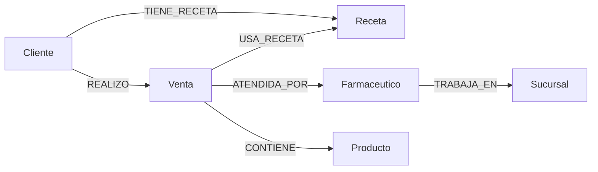

# Modelo de proyección FarmaRed

Diagrama del contrato implementado en grafo/mapeos.py y grafo/proyecciones.py;
no es una captura del servidor. La instancia sintética registrada en
cli_integracion_fixture.json verificó 7 nodos y 8 relaciones contra MongoDB.
Las seis unicidades de id realmente observadas están en restricciones_fixture.json.

CONTIENE representa una línea por (id_venta, id_detalle), con orden, cantidad,
precio_unit, subtotal y nombre_al_vender opcional. El fixture conserva D1 y D2 del
mismo producto CLI-P a precios 100 y 120. No se agregan stock, lotes ni proveedores.
Q10 recorre la sucursal actual del profesional, sin otra relación histórica.
