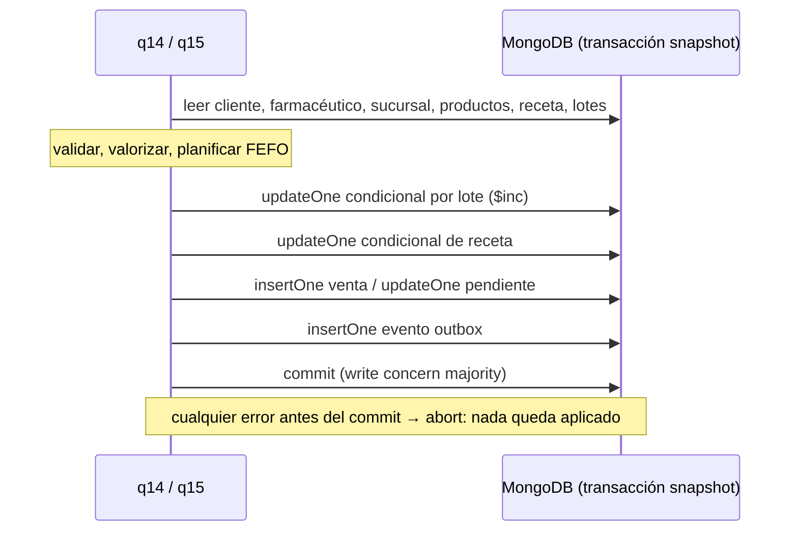

# Persona B — Ventas, receta y stock transaccional (q14 y q15)

**Ejecución de las evidencias:** 10/11/2026 (día comercial de Buenos Aires), MongoDB 8.0.15 en replica
set `rs0` de un miembro, base `farmared_demo_b` cargada con originales + adicionales
(`farmared setup --solo-mongo`). Las salidas citadas están en `docs/evidencias/b/`.

## 1. Decisiones adoptadas

| Tema | Decisión | Origen |
|---|---|---|
| Motor de q14/q15 | MongoDB, una transacción multidocumento por operación | Consigna §4 (q14+q15 integradas) |
| Alcance de la transacción | Venta + todos los lotes + receta + evento outbox | Contrato del equipo §2.1 |
| Neo4j | No participa; la venta se proyecta luego con `sync` (Persona D) | Plan §3.4 |
| q15 autónoma | Completa una venta **Pendiente** con el mismo coordinador que q14 | Interpretación documentada (§4) |
| Precio de una pendiente al completarse | Precio vigente del catálogo al completar | Plan §6.3 |
| Fecha de una pendiente al completarse | `fecha` = día de finalización; la original queda en `fecha_creacion_pendiente` | Contrato §2.1 |
| Lote vencido | `vencimiento < hoy`; el día de vencimiento todavía se dispensa | Supuesto declarado (plan §9) |
| Receta en una venta solo de venta libre | Se rechaza (`VALIDACION`), para no gastar una dispensa sin motivo | Decisión del equipo |
| Identidad de la operación | `id_venta` obligatorio y estable; `request_hash` del pedido | Contrato §2.2 |
| Dinero | Enteros ARS dentro de int64; nunca `float` | Contrato §2.1 |

## 2. Venta en MongoDB

Una venta es **un documento** con los ítems embebidos: no tienen vida propia, se crean y confirman
junto con la cabecera, y así el validador de esquema puede exigir `id_detalle` único dentro de la
venta. Cliente, farmacéutico, sucursal, receta, productos y lotes se **referencian** por id, porque
son compartidos y cambian por separado. Venta real generada por la demo (paso 1):

```json
{
  "_id": "B-DEMO-V1", "id_cliente": "A-C001", "id_farmaceutico": "A-F001",
  "id_sucursal": "A-S001", "id_receta": "A-RC001", "fecha": "2026-11-10",
  "tipo": "Con receta", "medio_pago": "Obra social", "estado": "Completada", "total": 15998,
  "items": [
    {"id_detalle": "B-DEMO-V1-D1", "id_producto": "A-PRD003", "cantidad": 6,
     "precio_unit": 1000, "subtotal": 6000,
     "asignaciones_lotes": [{"id_lote": "A-L002", "cantidad": 4}, {"id_lote": "A-L003", "cantidad": 2}]},
    {"id_detalle": "B-DEMO-V1-D2", "id_producto": "A-PRD001", "cantidad": 2,
     "precio_unit": 4999, "subtotal": 9998,
     "asignaciones_lotes": [{"id_lote": "A-L006", "cantidad": 2}]}
  ],
  "stock_aplicado": true, "receta_aplicada": true, "trazabilidad_lotes": "registrada",
  "origen": "servicio", "request_hash": "f0629f0c…de61d6"
}
```

(`fecha` es un BSON Date al inicio del día comercial, 03:00 UTC; la salida JSON lo muestra como día.)

| Campo | Para qué sirve |
|---|---|
| `id_sucursal` | Sucursal del farmacéutico al vender: donde se descontó el stock. |
| `items[].precio_unit`, `subtotal` | Precio histórico capturado al vender; un cambio de catálogo no altera la venta. |
| `items[].asignaciones_lotes` | Trazabilidad de qué lote abasteció cada línea. Para ventas históricas del CSV es `null` (desconocida). |
| `stock_aplicado` / `receta_aplicada` | Marcas de efectos ya aplicados: impiden volver a descontar o a dispensar. |
| `request_hash` | Huella SHA-256 del pedido normalizado, para distinguir reintento de conflicto. |
| `fecha_creacion_pendiente` | Fecha original de una pendiente completada por q15. |

## 3. q14 — Registrar una venta Completada

**Propósito.** Registrar una venta nueva en estado `Completada` (cabecera e ítems), validando
cliente existente y activo; farmacéutico existente, activo y de una sucursal tipo `Farmacia`
activa; productos existentes y activos; y, si algún producto es `Bajo receta` o `Bajo receta
archivada`, una receta existente, `Vigente`, del mismo cliente y con dispensas disponibles. El
total se calcula con los precios vigentes; el stock se descuenta por FEFO (q15 integrada) y la
receta registra la dispensa.

**Función.** `q14_registrar_venta(db, pedido, clock)` en `src/farmared/consultas/q14.py`.

| Parámetro | Contenido |
|---|---|
| `db` | `Database` de PyMongo conectada al replica set. |
| `pedido` | `{"id_venta", "id_cliente", "id_farmaceutico", "medio_pago", "items": [{"id_producto", "cantidad", "id_detalle"?}], "id_receta"?}` |
| `clock` | Reloj de negocio: el día comercial se toma del reloj del sistema, una vez por llamada. |

El pedido **no** trae precios, tipo de venta ni sucursal: se derivan del catálogo, de la condición
de los productos y del farmacéutico. Si una línea no trae `id_detalle`, se genera
`<id_venta>-D<n>`.

**Retorno.** `{"documento": venta, "eventos": [id_evento], "reutilizada": bool}`.

**Errores** (`ErrorDominio(codigo, mensaje)`; la CLI los imprime y sale con código 1):

| Código | Cuándo |
|---|---|
| `VALIDACION` | Pedido mal formado; cliente o farmacéutico inactivo; droguería o farmacia inactiva; producto inactivo; receta en una venta solo de venta libre. |
| `NO_EXISTE` | Cliente, farmacéutico, producto o receta inexistente. |
| `RECETA_INVALIDA` | Falta receta, es de otro cliente, no está `Vigente` o no tiene dispensas. |
| `STOCK_INSUFICIENTE` | Algún producto no alcanza con lotes vigentes de la sucursal; el mensaje lista todos los faltantes. |
| `CONFLICTO_ID` | El `id_venta` ya corresponde a otra venta u otro pedido. |
| `INTEGRIDAD` / `CONEXION` | Datos incoherentes o resultado incierto del motor: se reintenta con el **mismo** id. |

**Orden de validación** (el primer problema define el error): cliente → farmacéutico → sucursal →
productos → receta → precios → stock.

**CLI.**

```bash
farmared q14 --base farmared_demo_b --pedido pedido.json
```

### 3.1 Sentencias que modifican datos

Todas usan la misma sesión transaccional (`ClientSession.with_transaction`, read concern
`snapshot`, write concern `majority`, lectura en primario). Equivalente en shell para el paso 1:

```javascript
// Descuento condicional por lote: solo si sigue siendo de esa sucursal/producto, vigente y con saldo.
db.stock_lotes.updateOne(
  {_id: "A-L002", id_producto: "A-PRD003", id_sucursal: "A-S001",
   unidades: {$gte: 4}, vencimiento: {$gte: ISODate("2026-11-10T03:00:00Z")}},
  {$inc: {unidades: -4}})                                      // se exige modifiedCount == 1

// Dispensa condicional: solo si la receta sigue Vigente con el contador leído.
db.recetas.updateOne(
  {_id: "A-RC001", estado: "Vigente", dispensas_realizadas: 1},
  {$set: {dispensas_realizadas: 2, estado: "Vigente", proxima_dispensa: ISODate("2026-12-10T03:00:00Z")}})

db.ventas.insertOne({_id: "B-DEMO-V1", /* … documento de la sección 2 … */})
db.outbox.insertOne({_id: "0f3f208b-…", afectadas: [{coleccion: "ventas", id: "B-DEMO-V1"},
                     {coleccion: "recetas", id: "A-RC001"}], procesado: false, creado_en: ISODate("…")})
```

### 3.2 Ejemplo real: venta con receta y FEFO (demo, paso 1)

Pedido: cliente `A-C001`, farmacéutico `A-F001` (sucursal `A-S001`), receta `A-RC001`
(tratamiento prolongado), 6 × `A-PRD003` (bajo receta) y 2 × `A-PRD001`.

| Lote | Producto | Vence | Antes | Después | Motivo |
|---|---|---|---:|---:|---|
| A-L001 | A-PRD003 | 09/11/2026 | 100 | 100 | Vencido: se omite |
| A-L002 | A-PRD003 | 10/11/2026 | 4 | **0** | Vence hoy: se dispensa primero |
| A-L003 | A-PRD003 | 10/12/2026 | 10 | **8** | Completa la demanda (2) |
| A-L004 | A-PRD003 | 09/01/2027 | 20 | 20 | No hace falta |
| A-L016 | A-PRD001 | 11/10/2026 | 10 | 10 | Vencido: se omite |
| A-L006 | A-PRD001 | 09/01/2027 | 49 | **47** | Único lote vigente |

| Receta A-RC001 | Antes | Después |
|---|---|---|
| `dispensas_realizadas` / autorizadas | 1 / 3 | **2 / 3** (una dispensa por venta, no por ítem) |
| `estado` | Vigente | Vigente |
| `proxima_dispensa` | 09/11/2026 | **10/12/2026** (hoy + 30 días) |

Total: 6 × 1000 + 2 × 4999 = **15998**. La venta no existía antes y queda `Completada`.

### 3.3 Casos borde con salida real

| Paso de la demo | Resultado | Antes vs. después |
|---|---|---|
| 2 · Un ítem alcanza (1 × A-PRD003) y otro no (1000 × A-PRD001, vigentes 47) | `STOCK_INSUFICIENTE: … A-PRD001: pedido 1000, vigente 47.` | Idénticos: ningún lote, ni la receta (sigue 2/3), ni venta nueva |
| 3 · Cliente `C008` dado de baja | `VALIDACION: El cliente C008 está dado de baja.` | Idénticos |
| 4 · Reintento del pedido del paso 1, mismo id | `reutilizada: true`, `eventos: []` | Idénticos: no hay doble descuento ni doble dispensa |

Otros casos cubiertos por pruebas automáticas (sección 8): receta ajena, completada, inexistente
o agotada; farmacéutico inactivo o de droguería; farmacia inactiva; producto repetido en dos
líneas; mismo id con otro pedido; id de una venta del CSV.

### 3.4 Relación con otras entidades

| Relación | Resolución en MongoDB |
|---|---|
| Venta → ítems | Embebido (`items[]`), confirmado con la cabecera. |
| Venta → cliente, farmacéutico, receta, productos | Referencia por id, validada en la misma transacción (MongoDB no tiene claves foráneas). |
| Farmacéutico → sucursal | Referencia; la sucursal se lee para exigir tipo `Farmacia` activa y se copia en `id_sucursal`. |
| Ítem → lotes | `asignaciones_lotes`; los lotes se filtran por `(id_sucursal, id_producto)`. |
| Venta → grafo | Evento outbox en la misma transacción; Persona D lo proyecta a Neo4j. |

## 4. q15 — Actualización de stock FEFO de una venta registrada

**Propósito (consigna).** Dada una venta registrada, decrementar las unidades de cada producto
del detalle en los lotes de la sucursal del farmacéutico, aplicando FEFO y omitiendo lotes
vencidos. Si el stock vigente no alcanza para algún ítem, la operación completa se rechaza sin
modificar ningún lote.

**Interpretación.** q14 ya ejecuta este descuento dentro de su transacción, así que una venta
`Completada` nueva nunca existe sin stock aplicado. Para que q15 sea una función autónoma y
demostrable, se aplica a una venta **Pendiente**, que existe sin haber afectado stock: la revalida
con el mismo coordinador que q14 y la deja `Completada`. Es una interpretación del equipo,
pendiente de confirmación con la cátedra.

**Función.** `q15_actualizar_stock(db, id_venta, clock)` en `src/farmared/consultas/q15.py`.
Retorno y errores con el mismo formato que q14. CLI: `farmared q15 --base B --id-venta V011`.

| Estado de la venta | Resultado de q15 |
|---|---|
| `Pendiente` | Revalida cliente, profesional, sucursal, productos y receta; captura precios vigentes; FEFO; dispensa si corresponde; pasa a `Completada` con fecha de hoy. Ante rechazo, la pendiente queda **idéntica**. |
| `Completada` con `stock_aplicado=true` | Éxito previo, `reutilizada=true`: no vuelve a descontar (incluye ventas históricas del CSV). |
| `Completada` sin stock aplicado | `INTEGRIDAD`: no repara ventas corruptas. |
| `Anulada` | `VALIDACION`: no tiene efecto económico. |

La transición de la venta también es condicional
(`{_id, estado: "Pendiente", stock_aplicado: false, receta_aplicada: false}`): dos q15 simultáneas
sobre la misma pendiente no pueden completarla dos veces.

### 4.1 Ejemplo real: pendiente V011 (demo, paso 5)

| | Antes | Después |
|---|---|---|
| `estado` | Pendiente | **Completada** |
| `fecha` | 12/10/2026 | **10/11/2026** (ingreso atribuible al mes de finalización) |
| `fecha_creacion_pendiente` | 12/10/2026 | 12/10/2026 (conservada) |
| `total` / `precio_unit` | 4800 / 4800 | 4800 / 4800 (precio vigente sin cambios) |
| `asignaciones_lotes` | `[]` | `[{"id_lote": "L014", "cantidad": 1}]` |
| `stock_aplicado` / `receta_aplicada` | false / false | true / true |
| `origen` | csv | csv |
| Lote L014 (PRD007, sucursal S004 de F006) | 45 | **44** |
| Receta RC006 (simple) | 0/1, Vigente | **1/1, Completada**, próxima dispensa nula |

### 4.2 Caso de rechazo real: pendiente V012 (demo, paso 6)

`STOCK_INSUFICIENTE: Stock vigente insuficiente en S003; no se modificó ningún lote. PRD002:
pedido 2, vigente 0; PRD011: pedido 1, vigente 0.` El farmacéutico de V012 (F005) trabaja en
S003, que no tiene lotes de esos productos en el dataset de entrega. La venta queda igual:
`Pendiente`, fecha 11/10/2026, total 9200.

## 5. Algoritmo FEFO

Implementado una sola vez (`servicios/ventas/fefo.py`) y usado por q14 y q15:

1. **Demanda agregada:** se suman las cantidades de todas las líneas de cada producto, para no
   planificar dos veces sobre el mismo saldo.
2. **Lotes elegibles:** de la sucursal del farmacéutico, del producto, con `unidades > 0` y
   `vencimiento >= hoy`.
3. **Orden:** vencimiento ascendente y, ante empate, id de lote. El orden no depende del orden en
   que MongoDB devuelve los documentos.
4. **Todo o nada:** el plan se arma completo antes de escribir; si un producto no alcanza, la venta
   se rechaza y el error lista todos los faltantes.
5. **Asignación a líneas:** el plan se reparte entre las líneas en orden, y cada línea suma
   exactamente su cantidad. Con dos líneas del mismo producto (2 y 3 unidades) y lotes de 4 y 10:
   línea 1 `[L1×2]`, línea 2 `[L1×2, L2×1]`.

**Plan de ejecución** (`docs/evidencias/b/explain_fefo.json`): la lectura de lotes usa el índice
`ix_stock_lotes_fefo (id_sucursal, id_producto, vencimiento, _id)` creado por Persona A. El
planificador resuelve el `$in` de productos con un `IXSCAN` por producto unidos por `SORT_MERGE`,
sin ordenamiento en memoria: 4 claves y 4 documentos examinados, 3 devueltos (el lote en 0 se
descarta tras el `FETCH`). Con 34 lotes esto no demuestra una ventaja de rendimiento; muestra que
el índice cubre el filtro y el orden FEFO.

## 6. Receta

- Una venta requiere receta si algún producto es `Bajo receta` o `Bajo receta archivada`; el tipo
  de venta (`Con receta` / `Venta libre`) se deriva de eso, no lo declara quien pide.
- **Una dispensa por venta**, no por ítem.
- Simple y archivada: se completan con su única dispensa (`Completada`, próxima dispensa nula).
- Tratamiento prolongado: suma una dispensa; si quedan, `proxima_dispensa` = hoy + 30 días; si se
  alcanza el máximo, `Completada` y próxima nula.
- La consigna no exige que la dispensa ocurra a partir de `proxima_dispensa`, ni relaciona
  productos con recetas (la receta no los lista): no se valida ninguna de las dos cosas.

## 7. Consistencia: transacción, snapshot y concurrencia



- **Atomicidad.** Los cuatro tipos de escritura usan la misma sesión. Cualquier `ErrorDominio`,
  excepción o caída antes del commit aborta la transacción completa.
- **Snapshot.** Todas las lecturas de un intento ven la base en un mismo instante, ya confirmado
  por mayoría. No se mezclan datos de antes y después de otra venta concurrente.
- **Conflictos.** Si otra transacción confirma cambios sobre un lote o una receta que este intento
  también escribe, MongoDB responde `WriteConflict` (`TransientTransactionError`). El driver
  reintenta la operación completa con un snapshot nuevo, que replanifica el FEFO y revalida la
  receta.
- **Escrituras condicionales.** Son una segunda barrera: nunca se resta sin comprobar el saldo en
  el propio `updateOne`. Además, el validador de A impide `unidades < 0`.
- **Fecha.** El día comercial se toma del reloj una vez por llamada, así que un reintento del
  driver no cambia la fecha de la venta.

**Límite declarado.** MongoDB detecta conflictos sobre los documentos que la transacción
**escribe**, no sobre los que solo **lee**. Si un cliente es dado de baja mientras se confirma una
venta suya, la venta se confirma según el snapshot en que estaba activo. Tampoco se garantiza FEFO
respecto de un lote insertado después del snapshot. Lo que sí se garantiza y se prueba: no hay
stock negativo, no hay doble dispensa y no hay efectos parciales entre venta, receta, lotes y
outbox. Una garantía más fuerte exigiría un documento de guarda por (sucursal, producto) que todos
los escritores modifiquen.

## 8. Idempotencia, reintentos y pruebas

| Situación | Comportamiento |
|---|---|
| Mismo `id_venta`, mismo pedido | Devuelve la venta confirmada, `reutilizada=true`, sin eventos ni efectos nuevos. |
| Mismo `id_venta`, otro pedido o venta del CSV | `CONFLICTO_ID`, sin cambios. |
| Commit confirmado, respuesta perdida | Reintentar con el mismo id recupera la venta; **nunca** generar un id nuevo. |
| Dos q14 simultáneas con el mismo id | Una aplica, la otra recibe la venta confirmada (conflicto de escritura o clave duplicada). |
| Repetir q15 sobre una venta ya completada | Éxito previo sin repetir efectos. |

Suite de Persona B (`FARMARED_TEST_MONGO=1 pytest -v tests/ventas`, ejecutada el 10/11/2026):
**225 pruebas, todas aprobadas**,
de las cuales 85 corren contra MongoDB real en replica set, sin mocks (las otras 140 son reglas
puras y CLI sin motor). Las más relevantes:

| Prueba | Resultado verificado |
|---|---|
| Dos ventas de 4 unidades con saldo 5, en paralelo | Una confirma, otra `STOCK_INSUFICIENTE`; queda 1 unidad. |
| Dos ventas por la última dispensa | Una confirma, otra `RECETA_INVALIDA`; receta 3/3 `Completada`. |
| Dos q15 sobre la misma pendiente | Una transición, un descuento, un evento. |
| Caída después de descontar y dispensar, antes del commit | Las nueve colecciones idénticas a la foto previa. |
| Respuesta perdida tras el commit + reintento | Una venta, un evento, receta 2/3 (no 3/3). |
| Neo4j inaccesible | q14 confirma en un proceso que no importa el driver de Neo4j; el evento queda `procesado=false`. |
| Repetir el seed de A después de vender | No repone stock ni reinicia recetas. |

En las pruebas de concurrencia cada operación usa su propio `MongoClient` en un hilo, y ambas
transacciones esperan en una barrera después de leer: la carrera ocurre siempre, no depende del
planificador de hilos.

## 9. Integración con el resto del sistema

- **Persona A.** Usa sus contratos (`Clock`, `ErrorDominio`, `validar_importe_ars`), su conexión
  (`obtener_mongo`), su esquema (validadores e índice FEFO) y el seed para las pruebas oficiales.
  Los comandos `q14`, `q15` y `demo-transaccion` se registran en el router desde `cli_ventas.py`.
- **Persona C.** q14 lee directamente el documento del cliente; no llama al ABM de q13.
- **Persona D.** Cada operación confirmada deja un evento outbox que afecta la venta y, si hubo
  dispensa, la receta. El proyector de D resuelve el resto de las dependencias. Una venta nunca
  falla porque Neo4j esté caído.

## 10. Limitaciones

- La interpretación de q15 sobre ventas Pendientes es una decisión de diseño, no un texto de la
  consigna.
- El farmacéutico no tiene historial de traslados: se usa su sucursal actual al completar una
  pendiente.
- No hay anulación de ventas completadas con devolución de stock: la consigna no la pide.
- Los resultados de la demo dependen del día de ejecución: con otra fecha, A-L002 ya está vencido
  y el FEFO elige otros lotes.
- El replica set de un nodo habilita transacciones, pero no alta disponibilidad.

## 11. Evidencias y reproducción

| Archivo | Contenido |
|---|---|
| `docs/evidencias/b/demo_transaccion.json` | Seis pasos con parámetros, resultado y antes/después de lotes, recetas y ventas. |
| `docs/evidencias/b/explain_fefo.json` | Plan ganador y estadísticas de la consulta de lotes FEFO. |

```bash
farmared setup --solo-mongo --base farmared_demo_b --directorio data/originales --directorio data/adicionales
farmared demo-transaccion --base farmared_demo_b --salida docs/evidencias/b/demo_transaccion.json
FARMARED_TEST_MONGO=1 pytest -v tests/ventas
```
