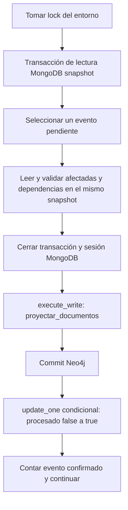

# D — Modelo de grafo, inicialización Neo4j y consultas Q03/Q04/Q10

Estado actual (prompt 10): implementación y E2E oficial auditados; ver [auditoría final](d_auditoria_final.md) y [resumen para integración](d_resumen_para_integracion.md). Ver [evidencias reales](../evidencias/d/e2e_oficial/README.md). Los registros previos de bloqueos y fixtures se conservan como historia identificada.

## Objetivo y alcance

MongoDB es la fuente de verdad operacional. Neo4j mantiene una proyección persistente
para recorrer clientes, ventas, recetas, profesionales, sucursales y productos.
Las relaciones explícitas permiten preparar el historial de un cliente (Q03), los
clientes con más de una receta (Q04) y los atendidos en una sucursal (Q10).
La entrega incluye restricciones, Q03/Q04/Q10, proyección explícita, consumidor recuperable, reconstrucción administrativa y verificación de equivalencia, ejecutados bajo demanda.
El consumidor lee documentos y outbox de MongoDB cuando se invoca sincronizar; no hay sincronización continua ni worker permanente. Neo4j no administra stock ni valida dispensas
y no participa en la transacción de ventas.

## Nodos y correspondencia con MongoDB

En las seis colecciones, `_id` pasa a `id`, conservando el string original
(por ejemplo C001, V001, RC001, F001, S001 y PRD001; adicionales con prefijo A-).
Los restantes campos se conservan con los nombres de MongoDB:

| Colección | Etiqueta | Propiedades de la proyección mínima |
| --- | --- | --- |
| clientes | Cliente | id, nombre, apellido, activo |
| ventas | Venta | id, fecha, tipo, estado, medio_pago, total |
| recetas | Receta | id, medico, tipo, fecha_emision, proxima_dispensa, estado, dispensas_autorizadas, dispensas_realizadas |
| farmaceuticos | Farmaceutico | id, nombre, apellido, matricula, activo |
| sucursales | Sucursal | id, nombre, tipo |
| productos | Producto | id, nombre, categoria |

No se proyectan proveedores, stock_lotes, datos de contacto, trazas de importación
ni asignaciones de lotes. No se modifica el esquema de A. El DDL de esta etapa no
impone obligatoriedad o tipos de las propiedades: Neo4j permite nodos sin `id` bajo
una restricción de unicidad; mapear_documento exige un ID presente y no vacío antes de escribir.

Los enums conservan sus valores originales y acentos, incluidos Venta libre,
Con receta, Completada/Pendiente/Anulada y los tipos/estados de receta definidos en
`farmared.contratos`. No se normalizan ni inventan valores.

## Relaciones

| Origen | Relación | Destino | Referencia MongoDB |
| --- | --- | --- | --- |
| Cliente | REALIZO | Venta | ventas.id_cliente |
| Cliente | TIENE_RECETA | Receta | recetas.id_cliente |
| Venta | USA_RECETA | Receta | ventas.id_receta, solo si no es null |
| Venta | ATENDIDA_POR | Farmaceutico | ventas.id_farmaceutico |
| Farmaceutico | TRABAJA_EN | Sucursal | farmaceuticos.id_sucursal |
| Venta | CONTIENE | Producto | ventas.items[].id_producto |

`CONTIENE` conserva cada línea de `ventas.items`: id_detalle, orden, cantidad,
precio_unit, subtotal y nombre_al_vender cuando esté disponible. `orden` se deriva
de la posición del array (base cero). MongoDB exige id_detalle único dentro de cada
venta, no entre ventas. La identidad lógica es (id_venta, id_detalle); dos líneas
con el mismo producto deben seguir siendo dos relaciones. En la implementación
actual se reemplazan dentro de una transacción las relaciones de detalle de esa Venta,
conservando id_detalle y reconciliando el destino si cambia el producto.
No alcanza un MERGE identificado solo por venta y producto. No se crean ItemVenta.
No se agrega una restricción global sobre CONTIENE.id_detalle porque sería incorrecta.

Los CSV no incluyen orden ni nombre_al_vender. La transformación de A conserva el
orden de lectura en items y calcula subtotal con cantidad * precio_unit. No se
puede reconstruir un nombre histórico desde productos.nombre: si no hay snapshot,
nombre_al_vender queda ausente. En Neo4j null significa propiedad ausente, también
para proxima_dispensa. El total de venta se conserva del documento autoritativo;
no se recalcula desde los detalles históricos.

**Decisión para Q10:** aunque ventas conserva id_sucursal en MongoDB, la consulta usa el recorrido literal por TRABAJA_EN y la sucursal actual del profesional. La arquitectura de esta etapa no contempla traslados históricos de farmacéuticos. Por eso no se agrega otra propiedad o relación ni se modifica MongoDB. Si se incorporan traslados, habrá que revisar cómo representar la atención histórica.

## Fechas y dinero

Los CSV usan YYYY-MM-DD. El loader persiste BSON Date como medianoche de
America/Argentina/Buenos_Aires convertida a UTC, según inicio_dia_utc.
El mapper convierte el datetime UTC a ZONA_COMERCIAL y después
obtiene date; el driver oficial puede persistir datetime.date como date Neo4j.
No se proyectan strings de fecha ni timestamps artificiales. proxima_dispensa puede
ser null. No se confunden estas fechas comerciales con creado_en técnico del outbox.
Los importes son enteros ARS, nunca floats, dentro del rango de validar_importe_ars.

## Restricciones e inicialización

`farmared.grafo.preparar_grafo(driver) -> None` reutiliza el driver recibido;
no abre otra conexión, no lo cierra y usa su base predeterminada (neo4j en Compose).
Compatible con Neo4j Community 5.26.12 y driver 6.4.1, sin APOC ni dependencias nuevas.
Ejecuta SHOW CONSTRAINTS antes y después del DDL:

```cypher
CREATE CONSTRAINT uq_cliente_id IF NOT EXISTS FOR (n:Cliente) REQUIRE n.id IS UNIQUE;
CREATE CONSTRAINT uq_venta_id IF NOT EXISTS FOR (n:Venta) REQUIRE n.id IS UNIQUE;
CREATE CONSTRAINT uq_receta_id IF NOT EXISTS FOR (n:Receta) REQUIRE n.id IS UNIQUE;
CREATE CONSTRAINT uq_farmaceutico_id IF NOT EXISTS FOR (n:Farmaceutico) REQUIRE n.id IS UNIQUE;
CREATE CONSTRAINT uq_sucursal_id IF NOT EXISTS FOR (n:Sucursal) REQUIRE n.id IS UNIQUE;
CREATE CONSTRAINT uq_producto_id IF NOT EXISTS FOR (n:Producto) REQUIRE n.id IS UNIQUE;
```

Se acepta una restricción equivalente con otro nombre. Un nombre reservado con
definición distinta produce ErrorDominio(INTEGRIDAD) antes del DDL. Errores reales
del driver/motor (conexión, permisos, índices incompatibles o datos duplicados) se
propagan: no se declara éxito ni se eliminan restricciones. Se consume cada resultado
para detectar errores diferidos y se verifica que las seis unicidades existan.
El DDL es incremental, no atómico entre restricciones: si falla, corregir la causa
y repetir. Coordinar la preparación sin cambios concurrentes del esquema.
No crea nodos, relaciones o datos de prueba, y no borra datos ni índices existentes.

Desde la raíz, después de uv sync --locked, con credenciales configuradas:

```powershell
uv run --locked --env-file .env python -c "from farmared.config import Config; from farmared.conexiones import obtener_neo4j; from farmared.grafo import preparar_grafo; driver = obtener_neo4j(Config.from_env()); preparar_grafo(driver); driver.close()"
```

Para garantizar cierre incluso ante una excepción, en código Python:

```python
from farmared.config import Config
from farmared.conexiones import obtener_neo4j
from farmared.grafo import preparar_grafo

with obtener_neo4j(Config.from_env()) as driver:
    preparar_grafo(driver)
```

La CLI actual expone grafo-init; los comandos y pruebas se detallan en la séptima etapa.

## Pruebas reproducibles

```powershell
uv run --locked pytest
$env:FARMARED_TEST_GRAFO = '1'
uv run --locked pytest tests/d_grafo
Remove-Item Env:FARMARED_TEST_GRAFO
```

Las unitarias verifican el DDL exacto, repetición, consumo de resultados, ausencia
de sentencias de datos, conflictos y propagación de errores de sesión, ejecución
y consumo. No sustituyen la comprobación real del motor.
La integración requiere Docker y la imagen exacta del Compose ya descargada.
Crea un contenedor exclusivo con puerto aleatorio local, contraseña aleatoria y
sin volúmenes montados; al terminar elimina ese contenedor con --rm. No usa .env
ni el destino de desarrollo. Verifica seis restricciones, repetición, preservación
de nodos y dos detalles del mismo producto y rechazo de IDs duplicados para cada
etiqueta. Sin opt-in queda omitida explícitamente; con opt-in una falla de arranque
o imagen ausente falla la prueba, no se informa como éxito.

## Pendientes

La CLI de D está integrada. La orquestación setup conjunta depende de A/C. Worker permanente y recuperación avanzada para despliegues mayores quedan fuera del alcance de D. La reconstrucción administrativa con escrituras pausadas y la verificación se describen en la sexta etapa. La función sincronizar bajo demanda se describe en la quinta etapa; no hay transacción distribuida ni garantía de frescura global de las consultas.

## Registro histórico de verificación inicial — 2026-11-10

Estas cifras pertenecen a la primera etapa, no al estado de entrega. La suite
actual y las omisiones de plataforma se informan en la auditoría final.

En Windows, con Python 3.14.10 y las dependencias de uv.lock:

- `uv run --locked pytest`: 182 aprobadas, 84 omitidas y 1 fallida.
  La falla está en `tests/infra/test_conexiones.py:149`, prueba existente
  `test_preparar_env_no_pisa_archivo_y_restringe_permisos`: espera permisos POSIX
  0600 y Windows devuelve 0666. Se reprodujo por separado (1 fallida en 0.08 s).
  No se modificaron archivos de A para ocultar o corregir esta diferencia de plataforma.
  Las integraciones A quedaron omitidas por sus variables opt-in.
- Primer intento de integración D: 10 aprobadas y 1 error de preparación porque
  faltaba la imagen Docker exacta. No se consideró una integración exitosa.
- Después de descargar la imagen fijada por digest en el Compose:
  `FARMARED_TEST_GRAFO=1 uv run --locked pytest tests/d_grafo -q`
  (variable establecida con sintaxis PowerShell): **11 aprobadas en 26.10 s**,
  incluida la integración real en el contenedor exclusivo, eliminado al terminar.

La base compartida no se utilizó para estas pruebas. En esa primera etapa la suite A
aún no estaba completamente aprobada en este host. El prompt 8 separó la comprobación
POSIX y el prompt 9 habilitó todas las integraciones, sin fallas vigentes.

## Q04 — Clientes con más de una receta

`farmared.consultas.q04.q04_clientes_con_recetas(driver) -> list[dict]` obtiene
los clientes con más de una receta registrada, con sus nombres y cantidad.

```cypher
MATCH (c:Cliente)-[:TIENE_RECETA]->(r:Receta)
WITH c, count(DISTINCT r) AS cantidad
WHERE cantidad > 1
RETURN c.id AS id_cliente, c.nombre AS nombre, c.apellido AS apellido, cantidad
ORDER BY cantidad DESC, id_cliente
```

TIENE_RECETA vincula al titular con la receta. Se cuentan nodos Receta distintos,
no relaciones repetidas, ventas ni dispensas. No hay filtros de actividad del
cliente o estado de receta: Vigente, Completada y Vencida cuentan por igual.
La agrupación por cliente produce una fila por cliente (con id único según el
esquema). El orden es cantidad descendente e id_cliente ascendente en los empates.
Sin clientes que superen el umbral devuelve [].

## Q10 — Clientes de una sucursal

`farmared.consultas.q10.q10_clientes_sucursal(driver, id_sucursal: str) -> list[dict]`
obtiene los clientes atendidos a través de ventas registradas por profesionales
asignados a la sucursal indicada.

```cypher
MATCH (s:Sucursal {id: $id_sucursal})
      <-[:TRABAJA_EN]-(f:Farmaceutico)
      <-[:ATENDIDA_POR]-(v:Venta)
      <-[:REALIZO]-(c:Cliente)
RETURN DISTINCT c.id AS id_cliente, c.nombre AS nombre, c.apellido AS apellido
ORDER BY id_cliente
```

El recorrido va de Sucursal a Farmaceutico por TRABAJA_EN, luego a Venta por
ATENDIDA_POR y finalmente a Cliente por REALIZO. DISTINCT evita repetir clientes
con múltiples ventas o atendidos por varios profesionales. No filtra activo de
clientes o farmacéuticos, ni estado de venta: Pendiente y Anulada también cuentan
si existe el recorrido. Una sucursal inexistente o sin ventas devuelve [].
El identificador se envía como parámetro al driver y nunca se interpola en Cypher.

Esta consulta adopta expresamente la sucursal actual del profesional. El proyecto
no contempla traslados históricos; esta decisión resuelve la observación de la
primera etapa sin ampliar el modelo. No se usa ventas.id_sucursal como atajo.

## Ejecución y comportamiento de las funciones

Ambas funciones usan el driver recibido y una sesión con READ_ACCESS y
execute_read. Los resultados se materializan con Result.data() dentro de la
transacción y se devuelven como list[dict]. Las sesiones se cierran incluso ante
errores. Los errores del driver se propagan; nunca se convierten en listas vacías.
El llamador mantiene y cierra el driver. No se inicializa esquema, abre otra
conexión ni escribe datos desde las consultas. Se usa la base predeterminada del
driver, igual que preparar_grafo.

```python
from farmared.config import Config
from farmared.conexiones import obtener_neo4j
from farmared.consultas.q04 import q04_clientes_con_recetas
from farmared.consultas.q10 import q10_clientes_sucursal

with obtener_neo4j(Config.from_env()) as driver:
    clientes_con_recetas = q04_clientes_con_recetas(driver)
    clientes_sucursal = q10_clientes_sucursal(driver, "S001")
```

Cargar las variables del entorno (por ejemplo con uv run --locked --env-file .env)
antes de invocar el código. Sin sincronizador ni carga a Neo4j, estas funciones
solo consultan lo que ya esté en el grafo: no se atribuyen resultados a los CSV.

## Pruebas de Q04/Q10

Las unitarias en test_q04.py y test_q10.py verifican la sentencia enviada, la
sesión de lectura, la materialización, el cierre y la propagación de errores al
abrir sesión, ejecutar y leer resultados. Comprueban resultados vacíos/no vacíos
y el envío seguro de un identificador con texto Cypher. Los mocks comprueban el
contrato Python; no se usan como evidencia de que Cypher tenga la semántica correcta.

La semántica se ejecuta realmente en test_consultas_integracion.py, en otro
contenedor temporal por módulo. El fixture Docker anterior ahora reside en
conftest.py para compartir su implementación con las pruebas de esquema, sin
cambiar sus casos. No se depende de MongoDB, outbox ni CSV.

Los datos sintéticos incluyen clientes con cero, una, dos y tres recetas,
una cliente inactiva, recetas en los tres estados, varias dispensas y una relación
TIENE_RECETA duplicada. Se comprueba la lista exacta y el orden de Q04, y también
el resultado vacío antes de insertar clientes con más de una receta.
Para Q10 hay tres sucursales (una con profesional pero sin ventas), farmacéuticos
activos e inactivos, clientes inactivos, múltiples ventas y profesionales para un
mismo cliente, y ventas Completada, Pendiente y Anulada. Se verifican resultados
exactos, exclusión de la otra sucursal, sucursal inexistente, entrada con texto
Cypher y ausencia de cambios en nodos, relaciones y sus propiedades.

```powershell
uv run --locked pytest tests/d_grafo/test_q04.py tests/d_grafo/test_q10.py -q
$env:FARMARED_TEST_GRAFO = '1'
uv run --locked pytest tests/d_grafo -q
uv run --locked pytest -q
Remove-Item Env:FARMARED_TEST_GRAFO
```

Estos resultados corresponden exclusivamente a fixtures de prueba, no al dataset
oficial. Las funcionalidades que faltaban en esa segunda etapa fueron completadas
y se describen en las etapas siguientes; el E2E oficial está en el prompt 9.


## Verificación de la segunda etapa — 2026-11-10

En Windows, Python 3.14.10 y dependencias de uv.lock:

- `uv run --locked pytest tests/d_grafo/test_q04.py tests/d_grafo/test_q10.py -q`:
  **19 aprobadas en 0.38 s**, sin omisiones ni fallas.
- Suite completa con `$env:FARMARED_TEST_GRAFO = '1'` y
  `uv run --locked pytest -q`: **213 aprobadas, 83 omitidas y 1 fallida en 61.68 s**.
  Dentro de esa ejecución pasaron **las 41 pruebas de D**, incluidas las 11
  existentes de la primera etapa y las 30 nuevas. Las 12 integraciones reales
  (11 de consultas y 1 de esquema) se ejecutaron con Neo4j 5.26.12 Community.
- La única falla continúa en la prueba existente de A
  `test_preparar_env_no_pisa_archivo_y_restringe_permisos`, línea 149 de
  tests/infra/test_conexiones.py: espera 0600 y Windows devuelve 0666.
  No se modificaron módulos ni pruebas de A para resolverla u ocultarla.
- Las 83 omisiones son las integraciones opt-in de A (MongoDB y motores), que no
  se activaron para esta ejecución. No se declaran aprobadas.
- Los dos contenedores temporales de D finalizaron y se eliminaron; se comprobó
  que no quedaron contenedores en ejecución. La base compartida no se utilizó.

El esquema del grafo y la infraestructura no se modificaron. El único ajuste a la
documentación del modelo fue adoptar para Q10 el recorrido por la sucursal actual,
con el supuesto explícito de ausencia de traslados históricos. Los resultados
anteriores son evidencia de fixtures controlados; no son resultados del dataset
oficial ni evidencia de una proyección sincronizada.


## Q03 — Historial completo de un cliente

`farmared.consultas.q03.q03_historial(driver, id_cliente: str) -> list[dict]`
obtiene todas las ventas y todas las recetas registradas de un cliente como eventos
independientes. No filtra actividad del cliente, estado ni fechas recientes.
Identificador inexistente o cliente sin historial devuelve []. No consulta MongoDB.

Valida que id_cliente sea un string y que no esté vacío ni compuesto solo por
espacios, con ErrorDominio(VALIDACION), siguiendo Config. No recorta ni normaliza
un ID válido: lo envía como parámetro. Usa sesión READ_ACCESS y execute_read,
materializa los resultados dentro de la transacción y cierra la sesión. Conserva
el driver del llamador y propaga errores del motor.

### Sentencia definitiva

```cypher
MATCH (c:Cliente {id: $id_cliente})
CALL (c) {
    MATCH (c)-[:REALIZO]->(v:Venta)
    WITH DISTINCT v
    CALL (v) {
        OPTIONAL MATCH (v)-[i:CONTIENE]->(p:Producto)
        WITH i, p ORDER BY i.orden, i.id_detalle
        RETURN collect(CASE WHEN i IS NULL THEN null ELSE {
            id_detalle: i.id_detalle, orden: i.orden, id_producto: p.id,
            nombre_al_vender: i.nombre_al_vender, cantidad: i.cantidad,
            precio_unit: i.precio_unit, subtotal: i.subtotal
        } END) AS items
    }
    RETURN v.fecha AS fecha, 'VENTA' AS tipo_evento, v.id AS id_registro,
           v.estado AS estado, {
               tipo: v.tipo, total: v.total, medio_pago: v.medio_pago,
               id_receta: head([(v)-[:USA_RECETA]->(r:Receta) | r.id]),
               items: items
           } AS detalle
    UNION ALL
    MATCH (c)-[:TIENE_RECETA]->(r:Receta)
    WITH DISTINCT r
    RETURN r.fecha_emision AS fecha, 'RECETA' AS tipo_evento, r.id AS id_registro,
           r.estado AS estado, {
               tipo: r.tipo, medico: r.medico,
               dispensas_realizadas: r.dispensas_realizadas,
               dispensas_autorizadas: r.dispensas_autorizadas,
               proxima_dispensa: r.proxima_dispensa
           } AS detalle
}
RETURN fecha, tipo_evento, id_registro, estado, detalle
ORDER BY fecha, tipo_evento, id_registro
```

El MATCH inicial busca Cliente.id. Una subconsulta con UNION ALL separa las ramas
REALIZO → Venta y TIENE_RECETA → Receta. De este modo dos ventas y dos recetas
producen cuatro eventos, no cuatro combinaciones ni repeticiones de ventas.
WITH DISTINCT evita repetir el mismo nodo si se duplican REALIZO o TIENE_RECETA.
El ORDER BY exterior ordena todo el conjunto, por fecha ascendente, tipo_evento
ascendente (RECETA antes de VENTA el mismo día) e id_registro ascendente.

Para cada venta, una subconsulta agrupa las relaciones CONTIENE hacia Producto.
Ordena por orden e id_detalle antes del collect; cada relación conserva su línea,
aunque otra apunte al mismo producto. No hay DISTINCT sobre productos o mapas de
ítems. collect omite el null del OPTIONAL MATCH cuando no hay detalles: devuelve
items=[] y mantiene el evento de venta. Los órdenes ausentes quedan al final,
según el orden ascendente de null en Cypher, y se desempata por id_detalle.
La comprensión de patrones USA_RECETA obtiene el ID opcional sin multiplicar las
filas de los detalles: head de una lista vacía devuelve null.

### Estructura y tipos

Cada evento tiene fecha, tipo_evento (VENTA o RECETA), id_registro, estado y detalle.

- VENTA: detalle contiene tipo, total, medio_pago, id_receta e items. Cada ítem
  contiene id_detalle, orden, id_producto, nombre_al_vender, cantidad, precio_unit
  y subtotal. Los valores históricos vienen de CONTIENE, nunca del precio o nombre
  actual de Producto. Si no existe snapshot del nombre, devuelve None; no lo inventa.
- RECETA: detalle contiene tipo, medico, dispensas_realizadas, dispensas_autorizadas
  y proxima_dispensa. Aparece como evento independiente aunque también sea la
  receta asociada a una venta. fecha corresponde a fecha_emision.

fecha y proxima_dispensa se convierten de neo4j.time.Date a datetime.date; una fecha
Python ya nativa se conserva. proxima_dispensa puede ser None. No se convierten
strings, enteros o datetimes a fechas: se rechazan con ErrorDominio(INTEGRIDAD),
al igual que una fecha obligatoria ausente. Un Date fuera del rango de date Python
propaga el error de conversión. No hay truncamiento, zona horaria inventada ni
parseo silencioso. Los importes se devuelven tal como están proyectados, enteros
ARS; no se recalcula el total histórico ni se consulta el catálogo para precios.

### Supuestos y límites

No se agregaron propiedades ni restricciones. Se espera la proyección acordada:
IDs únicos y presentes, fechas Neo4j date, dinero entero, id_detalle único por
venta y, como en ventas.id_receta de MongoDB, a lo sumo una receta por venta.
El esquema actual no impone cardinalidad de USA_RECETA: varios destinos distintos
constituyen un grafo fuera del contrato; Q03 no intenta reconstruir ni validar
esa cardinalidad. proyectar_documentos la garantiza al reconciliar USA_RECETA;
verificar_proyeccion detecta relaciones sobrantes fuera del contrato.
La consulta depende del contenido disponible en Neo4j y no garantiza frescura
sin sincronización. El orden cronológico usa el día comercial, sin inventar horas.
No hace falta pasar por Farmaceutico o Sucursal para obtener este historial.

```python
from farmared.config import Config
from farmared.conexiones import obtener_neo4j
from farmared.consultas.q03 import q03_historial

with obtener_neo4j(Config.from_env()) as driver:
    historial = q03_historial(driver, "C001")
```

### Pruebas de la tercera etapa

Las unitarias verifican validación previa a conectar, parámetros seguros, cierre,
errores del driver, conversión estricta de fechas y resultados completos anidados.
Los casos de prueba incluyen dos ventas y dos recetas intercaladas, empate por tipo
e ID el mismo día, recetas solas, ventas solas, cliente vacío o inexistente,
venta sin receta, varios productos, dos líneas del mismo producto, venta sin ítems,
estados Pendiente/Anulada y Completada/Vencida y cliente inactivo.
Como en Q04/Q10, los mocks verifican el contrato Python; la semántica Cypher se
verifica además con resultados exactos en Neo4j real.

Las integraciones de Q03 se agregan a test_consultas_integracion.py y reutilizan
el mismo driver y contenedor que Q04/Q10, sin iniciar otro contenedor para Q03.
Los fixtures Q03 tienen IDs propios y no afectan las verificaciones anteriores.
Insertan eventos y detalles en orden inverso, fechas reales Neo4j y precios/nombres
del catálogo diferentes de los históricos para comprobar el origen de los valores.
Comparan todos los campos, la ausencia de escrituras y una entrada con texto Cypher.
Todos estos datos son sintéticos y no son resultados del dataset oficial.

```powershell
uv run --locked pytest tests/d_grafo/test_q03.py -q
$env:FARMARED_TEST_GRAFO = '1'
uv run --locked pytest tests/d_grafo/test_consultas_integracion.py -k q03 -s
uv run --locked pytest tests/d_grafo -q
uv run --locked pytest -q
Remove-Item Env:FARMARED_TEST_GRAFO
```

El ejemplo impreso por el fixture de integración se obtiene llamando a
q03_historial contra el contenedor real, no imprimiendo la lista esperada.
El consumidor y la CLI que aún faltaban en esa tercera etapa están implementados
en las etapas quinta y séptima. La carga de MongoDB se reutiliza desde A. No se modificaron módulos de A/B/C ni Q04/Q10.

### Resultados ejecutados — 2026-11-10

En Windows, Python 3.14.10 y dependencias de uv.lock:

- Unitarias Q03: `uv run --locked pytest tests/d_grafo/test_q03.py -q`:
  **30 aprobadas**, última ejecución en 0.41 s.
- Suite general con FARMARED_TEST_GRAFO=1: `uv run --locked pytest -q -s`:
  **250 aprobadas, 83 omitidas y 1 fallida en 50.62 s**.
  En esa ejecución se verificaron **las 78 pruebas de D**, incluyendo las
  41 anteriores, las 30 unitarias Q03 y las 7 integraciones Q03 nuevas.
  Las 19 integraciones de D se ejecutaron realmente con Neo4j 5.26.12 Community.
  No hubo omisiones ni fallas de D.
- La falla registrada en esa etapa era la preexistente de A en
  tests/infra/test_conexiones.py:149, test_preparar_env_no_pisa_archivo_y_restringe_permisos:
  espera permisos POSIX 0600 y Windows devuelve 0666. No se alteró para ocultarla.
- Las 83 omisiones corresponden a las integraciones de A no activadas, no a Q03.
  No se declaran exitosas. No hubo regresiones nuevas observadas en las pruebas
  ejecutadas. No se accedió a la base compartida.

Ejemplo real obtenido al ejecutar q03_historial(driver, "Q03-COMPLETO") en el
contenedor aislado. Las fechas de la interfaz son datetime.date:

| fecha | tipo_evento | id_registro | estado |
| --- | --- | --- | --- |
| 2026-01-01 | RECETA | Q03-R1 | Completada |
| 2026-01-02 | VENTA | Q03-V1 | Pendiente |
| 2026-01-03 | RECETA | Q03-R2 | Vencida |
| 2026-01-03 | VENTA | Q03-V2 | Anulada |

El evento VENTA Q03-V1 devolvió este detalle (datos de prueba):

```python
{
    "tipo": "Con receta", "total": 470, "medio_pago": "Efectivo",
    "id_receta": "Q03-R1",
    "items": [
        {"id_detalle": "D1", "orden": 0, "id_producto": "Q03-P1",
         "nombre_al_vender": "Nombre histórico", "cantidad": 2,
         "precio_unit": 100, "subtotal": 200},
        {"id_detalle": "D2", "orden": 0, "id_producto": "Q03-P1",
         "nombre_al_vender": None, "cantidad": 1,
         "precio_unit": 120, "subtotal": 120},
        {"id_detalle": "D3", "orden": 1, "id_producto": "Q03-P2",
         "nombre_al_vender": None, "cantidad": 3,
         "precio_unit": 50, "subtotal": 150},
    ],
}
```

Q03-V2 devolvió id_receta=None e items=[]. Q03-R2 devolvió
proxima_dispensa=datetime.date(2026, 2, 1). No se usaron los 99999 pesos ni el
nombre actual del producto introducidos deliberadamente en el fixture.
La unidad de integración Q03 comparte el contenedor existente de consultas; no
se cambió el ciclo de vida Docker ni se crearon contenedores extra para esta consulta.


## Proyección explícita de documentos — cuarta etapa

La capa nueva recibe documentos ya obtenidos por el llamador. No conecta MongoDB,
no importa el loader en producción, no procesa outbox, no es un sincronizador ni
hace reconstrucciones o cargas CSV. No se modifican Q03/Q04/Q10 ni contratos de A.

### API pública

- `farmared.grafo.mapeos.mapear_documento(coleccion, documento) -> dict`:
  transformación pura, sin motores ni mutación de la fuente. Devuelve etiqueta,
  propiedades planas, referencias por tipo de relación y los detalles de venta.
- `farmared.grafo.mapeos.fecha_comercial(valor) -> datetime.date`:
  datetime BSON consciente de zona → Buenos Aires → día comercial. También acepta
  date nativo. Rechaza datetimes naive, strings y otros tipos. obtener_mongo de A
  ya entrega UTC consciente de zona; no se supone una zona para datos ambiguos.
- `farmared.grafo.proyecciones.proyectar_documento(tx, coleccion, documento) -> None`:
  proyecta un agregado; exige sus dependencias completas ya disponibles en el grafo.
- `farmared.grafo.proyecciones.proyectar_documentos(tx, documentos) -> None`:
  recibe una secuencia de pares (coleccion, documento). Permite dependencias completas
  conocidas en la misma unidad de trabajo, en cualquier orden. No acepta dos estados
  del mismo ID/colección en una unidad: debe elegirse previamente el autoritativo.

Ambas operaciones reciben una transacción activa, no un Driver. No abren sesiones,
no hacen commit y no cierran la transacción. El llamador debe dejar que cualquier
excepción escape de execute_write o begin_transaction para que se revierta toda
la unidad de trabajo; no debe capturar el error y confirmar los pasos previos.
El consumidor utiliza esta API dentro de execute_write para controlar el commit Neo4j.
Los callbacks de execute_write pueden reintentarse; estas operaciones no tienen
efectos externos y repetirlas produce el mismo estado lógico del grafo.

### Mapeo y validación

Se conservan las propiedades mínimas de las seis etiquetas de la tabla inicial.
_id se convierte a id string. No se usan atributos mutables como identidad.
La validación abarca los datos que consume el grafo; no duplica el validador de
campos operacionales de MongoDB (DNI, contactos, stock, flags de aplicación, etc.).
Los campos requeridos ausentes, tipos incorrectos, enums desconocidos e IDs vacíos
producen ErrorDominio(VALIDACION). No se interpretan parches parciales como estados
completos ni se actualiza parcialmente un nodo a partir de un documento incompleto.

Los booleanos deben ser bool. Cantidades, dispensas e importes deben ser enteros,
rechazando bool y floats, con los límites de contratos y esquema A. BSON Int64 se
normaliza a int Python. Se conserva el total y cada precio/subtotal del documento,
sin recalcular valores históricos ni tomarlos del Producto actual.

fecha, fecha_emision y proxima_dispensa pasan a date. Por ejemplo,
2026-01-02 01:00 UTC corresponde al día comercial 2026-01-01; extraer .date() antes
de convertir la zona sería incorrecto. proxima_dispensa, id_receta y nombre_al_vender
pueden estar ausentes o ser None. La asignación null elimina la propiedad Neo4j,
por lo que las consultas existentes siguen devolviendo sus opcionales como None.

Ventas se obtiene de un documento con items embebidos, no de una colección de
detalles. Se exige una lista no vacía, como en el validador MongoDB; las ventas sin
ítems permitidas en fixtures de Q03 no son documentos autoritativos válidos para
esta capa. orden deriva de enumerate(items), base cero, aunque el item tenga otra
propiedad orden. id_detalle debe ser único dentro de cada venta. nombre_al_vender
solo se proyecta si existe en el documento; no se reconstruye desde el catálogo.
No se proyectan importacion, asignaciones_lotes, proveedores, stock ni metadatos
operacionales. Los mapas de referencias e ítems son parámetros de trabajo, no
propiedades anidadas de nodos: solo los mapas planos correspondientes se asignan
con SET n += $props o SET r = $props.

### Creación, dependencias y reconciliación

1. Mapear y validar todos los documentos antes de la primera escritura.
2. MERGE de cada nodo por etiqueta e id, actualizando las propiedades acordadas.
   Se conservan propiedades ajenas a esta proyección; los opcionales conocidos
   siempre se asignan, incluso cuando son None para retirar un valor anterior.
3. Verificar todas las dependencias por etiqueta e id, exigiendo exactamente un
   nodo con los campos obligatorios de su proyección presentes. Un stub solo con
   id no alcanza. Los nodos existentes se asumen del modelo acordado; este chequeo
   no reemplaza una auditoría de tipos de datos de un grafo ajeno.
4. Reemplazar exclusivamente las relaciones propiedad de cada agregado y verificar
   que cada CREATE haya encontrado un único par de extremos. Un MATCH sin filas
   nunca se considera éxito.

Las referencias faltantes o incompletas producen ErrorDominio(INTEGRIDAD). Los
errores reales de Neo4j se propagan. Una falla después del MERGE de nodos se revierte
al abortar la transacción del llamador; se prueba el rollback del nodo y de cambios
anteriores de la unidad. No se crean stubs para disimular referencias inexistentes.
Se requiere haber ejecutado preparar_grafo antes para garantizar unicidad.

La propiedad de relaciones se delimita así:

| Agregado actualizado | Relaciones que puede reemplazar |
| --- | --- |
| Cliente, Sucursal, Producto | Ninguna |
| Farmaceutico | TRABAJA_EN salientes de ese farmacéutico |
| Receta | TIENE_RECETA entrantes de esa receta |
| Venta | REALIZO entrantes y ATENDIDA_POR, USA_RECETA y CONTIENE salientes de esa venta |

Se retiran esas relaciones y se crean las del estado autoritativo en la misma
transacción. Esto también reconcilia cambios de destino (cliente, profesional,
receta o producto), relaciones duplicadas y opcionales retirados. No se eliminan
nodos, relaciones de otras ventas ni las ventas o recetas omitidas de una unidad
parcial. Proyectar Cliente no elimina sus ventas o recetas.
La estrategia es reemplazo lógico: los elementId de las relaciones pueden cambiar
al repetir una proyección. No se promete estabilidad de identificadores internos
Neo4j. Para CONTIENE la identidad de negocio es (id_venta, id_detalle), nunca el
producto; después de retirar los detalles anteriores se crea una relación por
item. Así dos líneas del mismo producto permanecen independientes, un cambio de
producto no deja un vínculo viejo y una línea ausente se retira sin borrar Producto.

ventas.id_sucursal no reemplaza TRABAJA_EN ni se utiliza para proyectar otra
sucursal histórica. Q10 conserva exactamente el recorrido por farmacéutico. La
proyección puede actualizar la asignación actual; no reconstruye traslados históricos.

### Ejemplo de dos detalles del mismo producto

Con dependencias ya proyectadas completas, la venta siguiente se confirma como
una unidad. Los datos son sintéticos; no son resultados del dataset oficial.

```python
from datetime import UTC, datetime
from farmared.config import Config
from farmared.conexiones import obtener_neo4j
from farmared.grafo.proyecciones import proyectar_documento, proyectar_documentos

venta = {
    "_id": "V-PRUEBA", "id_cliente": "C-PRUEBA",
    "id_farmaceutico": "F-PRUEBA", "id_receta": None,
    "fecha": datetime(2026, 1, 2, 3, tzinfo=UTC),
    "tipo": "Venta libre", "estado": "Completada",
    "medio_pago": "Efectivo", "total": 320,
    "items": [
        {"id_detalle": "D1", "id_producto": "P-PRUEBA",
         "cantidad": 2, "precio_unit": 100, "subtotal": 200},
        {"id_detalle": "D2", "id_producto": "P-PRUEBA",
         "cantidad": 1, "precio_unit": 120, "subtotal": 120},
    ],
}
with obtener_neo4j(Config.from_env()) as driver:
    with driver.session() as sesion:
        sesion.execute_write(proyectar_documento, "ventas", venta)
```

Para proporcionar las dependencias en el mismo commit, usar documentos completos
obtenidos por el llamador, incluyendo la sucursal del farmacéutico:

```python
sesion.execute_write(proyectar_documentos, [
    ("ventas", venta), ("clientes", cliente), ("farmaceuticos", farmaceutico),
    ("productos", producto), ("sucursales", sucursal),
])
```

Si venta.id_receta no es None, incluir también la receta y su titular completo
si aún no existen. No hay resolución mediante lecturas MongoDB dentro de la API.

### Verificación de esta capa

Las unitarias nuevas cubren las seis conversiones, fechas alrededor de medianoche
UTC, tipos, BSON Int64, campos ausentes, malformados, detalles repetidos, referencias,
precios históricos, no mutación de la fuente, validación de la unidad antes de
escribir y propagación de errores del driver sin commit propio.

La compatibilidad con la transformación real de A se prueba sin motores usando
los originales y adicionales generados por A en un directorio temporal. Se detectó
que los adicionales versionados de este checkout no coinciden con los hashes de
su manifiesto (11 diagnósticos: huella de originales, perfil y nueve CSV). No se
modificaron esos archivos ni sus hashes para evitar el rechazo. La prueba temporal
no se presenta como validación exitosa de los adicionales versionados.

Las integraciones reutilizan el fixture Docker aislado existente, con un único
contenedor para el módulo de proyecciones, sin volúmenes compartidos. Comprueban
la inserción/repetición/actualización del cliente, las seis relaciones, idempotencia
de detalles del mismo producto, cambios de ítems/precios/producto, cambio y retiro
de receta, reasignación de cliente/profesional/sucursal/titular, retirada de una
fecha opcional, dependencias ausentes/incompletas y rollback de toda la unidad.
Verifican que otras ventas conservan incluso sus relaciones y que no se borran
productos. Ejecutan Q03, Q04 y Q10 reales sobre los datos producidos por la API,
comparando los valores exactos con los esperados del fixture.

```powershell
uv run --locked pytest tests/d_grafo/test_mapeos.py -q
$env:FARMARED_TEST_GRAFO = '1'
uv run --locked pytest tests/d_grafo/test_proyecciones_integracion.py -q
uv run --locked pytest tests/d_grafo -q
uv run --locked pytest -q
Remove-Item Env:FARMARED_TEST_GRAFO
```

El consumidor implementado en la quinta etapa selecciona eventos, lee snapshots y
confirma outbox después de Neo4j. Los borrados físicos y la sincronización automática
quedan fuera de alcance. No hay una transacción distribuida entre motores.

### Resultados ejecutados — cuarta etapa, 2026-11-10

Windows, Python 3.14.10, dependencias de uv.lock y Neo4j Community 5.26.12:

- Unitarias nuevas: `uv run --locked pytest tests/d_grafo/test_mapeos.py -q`:
  **46 aprobadas en 0.49 s**. Incluye mapeos y contratos de la API transaccional.
- Primera integración nueva: **10 aprobadas en 31.23 s**. Se añadió después un caso
  de reasignación de cliente/profesional y preservación de otra venta; ese caso se
  ejecutó con el resto en la suite final.
- Suite general final con FARMARED_TEST_GRAFO=1: `uv run --locked pytest -q`:
  **307 aprobadas, 83 omitidas y 1 fallida en 91.22 s**.
  Dentro de ella pasaron **las 135 pruebas de D**: 78 anteriores y 57 nuevas
  (46 unitarias y 11 integraciones de proyección). Las 30 integraciones de D
  se ejecutaron realmente contra Neo4j; ninguna fue omitida o fallida.
- La única falla registrada en esa etapa estaba en tests/infra/test_conexiones.py:149,
  test_preparar_env_no_pisa_archivo_y_restringe_permisos, que exige 0600 mientras
  Windows informa 0666. No se modificó A para corregirla u ocultarla.
- Las 83 omisiones son integraciones de A no activadas. No se declaran aprobadas.
  No se observaron regresiones nuevas en los casos ejecutados.

Los resultados de Q03/Q04/Q10 corresponden a fixtures escritos por las nuevas
funciones de proyección. No se presentan como resultados oficiales del dataset
completo ni como evidencia de sincronización automática. La comprobación del loader
transforma originales y adicionales temporales sin cargarlos a Neo4j ni a MongoDB.
La discrepancia del manifiesto de adicionales versionados queda informada arriba,
sin cambiar CSV, manifiestos ni validadores de A.

Archivos de esta etapa: src/farmared/grafo/mapeos.py,
src/farmared/grafo/proyecciones.py, tests/d_grafo/test_mapeos.py y
tests/d_grafo/test_proyecciones_integracion.py (nuevos); tests/d_grafo/conftest.py
(fixture de documentos sintéticos) y este informe (actualizados).
No se modificaron los módulos de A/B/C, las consultas existentes, el esquema,
la infraestructura, la CLI o las dependencias.


## Consumidor recuperable de outbox — quinta etapa

### Contrato y alcance

`from farmared.proyeccion import sincronizar`

```python
def sincronizar(db, driver, lock_path, *, max_eventos: int | None = None) -> dict:
    ...
```

Recibe Database y Driver ya abiertos mediante obtener_mongo y obtener_neo4j.
No crea conexiones ni cierra las del llamador. Requiere preparar_grafo ejecutado
previamente. max_eventos admite None o un entero no negativo, excluyendo bool;
0 toma el bloqueo y observa pendientes sin proyectar ni marcar eventos.
El padre de lock_path debe existir y todos los consumidores del mismo entorno
deben usar el mismo archivo. No es un nuevo comando CLI ni inicia un worker.

El contrato real de A se conserva sin cambios:

```python
{
    "_id": "identificador-estable-string",
    "afectadas": [{"coleccion": "ventas", "id": "V001"}],
    "procesado": False,
    "creado_en": datetime_con_fecha_bson,
}
```

A emite IDs deterministas por entidad en el seed y registra los eventos junto con
sus documentos dentro de una transacción MongoDB. afectadas es una lista: el
consumidor admite varias entidades y resuelve identidades compartidas una sola vez.
Se validan ID no vacío, lista no vacía y sin pares repetidos, seis colecciones
permitidas, estado pendiente booleano y creado_en datetime. No se agregan campos
al evento. No se consumen proveedores, stock_lotes ni colecciones técnicas.

### Flujo de un evento



Cada iteración abre una sesión nueva sobre el primario y una transacción de lectura
con ReadConcern(snapshot). El evento se elige con procesado=False, ordenado por
creado_en y _id para selección determinista y aprovechando el índice de A.
Ese orden es solo una política de recorrido: timestamps y UUID no representan un
orden global de commits. No se lee un ID primero para después consultar documentos
fuera de su snapshot. Evento y dependencias siempre usan la misma sesión.

La vista representa el estado actualmente visible al snapshot, que puede ser más
reciente que el commit que originó un evento antiguo. No intenta recuperar versiones
históricas ni reproducir deltas de aquel commit. Una escritura posterior al comienzo
del snapshot se verá en otra ejecución/iteración a través de su evento pendiente.
La transacción y sesión MongoDB se cierran antes de abrir la sesión Neo4j: no se
mantienen recursos transaccionales MongoDB esperando confirmaciones del otro motor.

resolver_documentos usa el mapper existente para validar y obtener referencias;
recorre cliente, sucursal del profesional, profesional, receta/titular y productos
según corresponda, en postorden. Elimina duplicaciones por (colección, id), detecta
ciclos explícitamente y devuelve dependencias antes de sus entidades dependientes.
No necesita que se hayan procesado antes los eventos de maestros. Cada documento
completo se obtiene del mismo snapshot. Un documento raíz o una dependencia ausente
hace fallar el evento; no se crea un stub. No se infiere una baja por ausencia.

La escritura usa únicamente proyectar_documentos dentro de execute_write. No se
repiten mapeos ni Cypher en el consumidor. Todos los nodos y relaciones del evento
comparten un commit Neo4j. El driver puede efectuar sus reintentos transaccionales
acotados por la configuración existente. No hay un bucle de reintentos del consumidor
para un evento fallido. El mapper y las proyecciones mantienen la semántica ya
probada de precios históricos, líneas repetidas y reconciliación de relaciones.

### Ack posterior y recuperación

Solo después de que execute_write retorna exitosamente se hace:

```python
db.outbox.update_one(
    {"_id": id_evento, "procesado": False},
    {"$set": {"procesado": True}},
)
```

Se exige respuesta acknowledged, matched_count=1 y modified_count=1. Nunca se marcan
eventos en bloque ni antes del commit Neo4j. Se utiliza WriteConcern(majority) para
el ack y ReadConcern(majority) para la observación final, incluso si el Database
recibido tenía otras opciones. No se vuelve a seleccionar un evento ya procesado.

Si Neo4j falla antes de confirmar, el evento permanece pendiente. Si Neo4j confirma
pero el ack falla antes de escribirse, el siguiente intento vuelve a leer el estado
actual y repite una proyección idempotente. Un evento antiguo reentregado no aplica
una copia vieja del documento: vuelve a resolverlo desde MongoDB.

Una pérdida de respuesta de red puede dejar incierto si un commit Neo4j o un ack
MongoDB llegaron a persistirse. El consumidor no intenta deshacer un commit ya
confirmado ni fuerza procesado=False para resolver esa incertidumbre. Informa el
error y en la siguiente invocación vuelve a observar los pendientes: si el ack sí
persistió, ese evento no se vuelve a seleccionar; si sigue pendiente, la proyección
se puede repetir. No hay exactamente una entrega ni una transacción ACID conjunta.

### Resumen y errores

El resultado es serializable como JSON y contiene:

| Campo | Significado |
| --- | --- |
| procesados | Eventos cuyo commit Neo4j y ack MongoDB se confirmaron en esta ejecución |
| eventos_procesados | IDs de esos eventos |
| pendientes_observados | Conteo majority puntual al finalizar; None si no se pudo observar |
| fallidos | Lista de id_evento, codigo, causa y neo4j_confirmado |
| limite_alcanzado | Se alcanzó el número configurado, incluso 0; no asegura que haya más pendientes |
| estado | sin_pendientes_observados, pendientes_observados, limite_alcanzado o error |

Un fallo detiene el procesamiento del resto de eventos, sin pasar al siguiente ni
reintentar indefinidamente el mismo. El conteo final puede agregar otro diagnóstico
si MongoDB tampoco permite observar pendientes. El ID es None si falló antes de
identificar un evento. No se imprimen documentos, URI, credenciales o nombres de
clientes en los diagnósticos del consumidor. Los ejemplos impresos en tests son
fixtures identificados expresamente como datos sintéticos.

| Código | Condición |
| --- | --- |
| EVENTO_INVALIDO | Contrato outbox mal formado |
| DOCUMENTO_INEXISTENTE | Entidad afectada ausente |
| DEPENDENCIA_INEXISTENTE | Referencia obligatoria ausente |
| DOCUMENTO_INVALIDO | Mapper rechaza campos o identidad fuente |
| CICLO_DEPENDENCIAS | Referencias cíclicas |
| MONGO_CONEXION / MONGO_LECTURA | Error de conexión o de lectura/observación MongoDB |
| NEO4J_CONEXION | Error del driver al ejecutar/confirmar Neo4j |
| NEO4J_ESCRITURA | Error del servidor Neo4j en la transacción |
| PROYECCION_INTEGRIDAD | La proyección no pudo asegurar extremos/relaciones |
| OUTBOX_CONFIRMACION | Commit Neo4j confirmado, ack no confirmado |

Argumentos inválidos levantan ErrorDominio(VALIDACION). Un lock ocupado levanta
ErrorDominio(SYNC_EN_CURSO) antes de acceder a los motores. Errores inesperados
no se disfrazan de éxitos: se propagan y el lock se libera igualmente. Errores de
archivo/permisos al abrir el lock se propagan; no se interpretan como lock ocupado.

Un conteo puntual de cero pendientes no certifica sincronización globalmente
completa: pueden aparecer nuevos commits después o faltar eventos por escrituras
que no respetaron el contrato. Si llegan eventos entre el snapshot vacío y el conteo final positivo, el estado indica pendientes_observados y termina sin iniciar polling. Si también el conteo es cero, el estado dice sin_pendientes_observados y no
completa. El llamador debe revisar estado y fallidos, no solo procesados.

### Exclusión real entre procesos

exclusion.py usa bloqueo de un byte con msvcrt.LK_NBLCK en Windows y flock exclusivo
no bloqueante en Unix, ambos de biblioteca estándar. El contenido/existencia del
archivo no representa la propiedad del lock. El descriptor permanece abierto durante
toda la ejecución, incluido el ack y la observación final. El SO libera el bloqueo
al cerrar el descriptor o terminar el proceso, incluso tras una caída. El archivo
no se elimina al liberar el lock: borrarlo/reemplazarlo mientras haya consumidores
podría permitir bloquear inodos/archivos diferentes y perder la exclusión.

La protección solo alcanza procesos que abren el mismo archivo, sobre un filesystem
que soporte el mecanismo de locking correspondiente. No proporciona exclusión
distribuida entre hosts con archivos locales distintos. Desplegar todos los
consumidores con el mismo path/volumen es una precondición; en esta etapa no se
implementan leases MongoDB, fencing ni múltiples consumidores.
Las pruebas actuales ejercitaron la rama Windows, incluido un proceso hijo real.
La rama Unix está implementada, pero no se declara ejecutada en este host Windows.

### Consistencia eventual y condiciones de convergencia

MongoDB sigue siendo la autoridad: ventas y autorización de stock/dispensas no
esperan a Neo4j. El grafo persiste su estado entre invocaciones y las consultas
leen esa proyección, que puede estar atrasada. La convergencia requiere:

- Un único consumidor efectivo mediante el mismo lock.
- Todo cambio de negocio confirmado junto con su evento outbox inmutable.
- Lecturas consistentes del estado actual y de dependencias completas.
- Un commit Neo4j por evento y ack posterior comprobado.
- Proyección idempotente del estado autoritativo y ausencia de escrituras de negocio
  directas en Neo4j.
- Reintento explícito tras corregir errores y ejecución posterior para atender
  nuevos eventos. No se dan por resueltas eliminaciones físicas sin política de bajas.

Estas condiciones permiten procesar/reentregar eventos antiguos sin volver
intencionalmente a versiones antiguas. No representan ACID entre los dos motores,
ni garantizan frescura mientras continúan las escrituras o un evento bloquea la cola.

### Uso directo con conexiones existentes

Con variables de entorno cargadas y un directorio compartido existente para el lock:

```python
from pathlib import Path
from farmared.config import Config
from farmared.conexiones import obtener_mongo, obtener_neo4j
from farmared.grafo import preparar_grafo
from farmared.proyeccion import sincronizar

config = Config.from_env()
db = obtener_mongo(config)
try:
    with obtener_neo4j(config) as driver:
        preparar_grafo(driver)
        resumen = sincronizar(db, driver, Path("farmared-sync.lock"), max_eventos=100)
        if resumen["fallidos"]:
            raise RuntimeError(resumen["fallidos"])
finally:
    db.client.close()
```

Este fragmento no inicia un proceso permanente ni incorpora un comando CLI. Se debe
usar una ruta compartida acordada para el entorno, no una carpeta temporal distinta
por consumidor. No hay nuevas dependencias ni cambios en el esquema MongoDB.

### Pruebas reales de esta etapa

Las unitarias separadas usan dobles para MongoDB/driver y comprueban selección de
pendientes, omisión, varias afectadas, dependencias y orden, ciclos, documentos
faltantes, errores, snapshot cerrado antes de Neo4j, ack posterior al commit,
resultado condicional del ack, reintento explícito, límite y validación. Un test
lanza otro proceso Python que toma el lock, rechaza una sincronización concurrente
y luego termina abruptamente; el archivo persiste pero se puede bloquear nuevamente.
No se presenta ese test como una integración de motores.

Las nueve integraciones de test_consumidor_integracion.py usan el fixture Neo4j
existente y un MongoDB replica set temporal adicional, con la imagen exacta por
digest del Compose. Solo crean/eliminan bases farmared_test_d_sync_<UUID> dentro
de ese contenedor nuevo, sin volúmenes de desarrollo. No modifican Compose ni
inicializan/reconfiguran el replica set compartido. Cada caso inserta documentos
válidos bajo el esquema real de A y eventos confirmados en una transacción MongoDB.

Casos realmente ejecutados:

- A: siete eventos, venta seleccionada antes de los maestros, resolución completa,
  Q03/Q04/Q10 reales y segunda invocación sin procesar eventos ya confirmados.
- B: reentrega controlada del mismo evento, comparación del estado lógico completo
  del grafo sin duplicar nodos o líneas.
- C: driver real hacia un puerto reservado sin listener, evento pendiente y posterior
  recuperación con el driver conectado al Neo4j real.
- D: venta con producto ausente, evento pendiente y grafo sin cambios parciales.
- E: venta pendiente que se completa, cambia precio/ítems y retira receta;
  reentrega de un evento antiguo conserva el estado actual, no restaura el anterior.
- F: fallo inyectado justo antes del ack, después del commit Neo4j real; proyección
  visible y evento pendiente, seguidos de reentrega sin duplicaciones.
- G: dos llamadas simultáneas a sincronizar con el mismo archivo; solo una procesa.
- Snapshot real: una segunda transacción cambia cliente y emite otro evento mientras
  está abierta la lectura snapshot. La primera conserva el estado anterior consistente;
  la siguiente invocación aplica el nuevo estado. Se verifica que la sesión MongoDB
  ya terminó cuando comienza la proyección Neo4j.
- Rollback real: fallo inyectado después de escribir el subgrafo pero antes del
  commit Neo4j; no quedan escrituras parciales y no se confirma outbox.

Los fallos de F y rollback son inyecciones controladas, con commits/rollback de los
motores reales; no se afirma que se haya producido una caída física de MongoDB.
G usa dos llamadas concurrentes en hilos; la exclusión entre procesos se comprueba
además con el proceso hijo real de las unitarias.

```powershell
uv run --locked pytest tests/d_grafo/test_consumidor.py -q
$env:FARMARED_TEST_SYNC = '1'
uv run --locked pytest tests/d_grafo/test_consumidor_integracion.py -q -s
$env:FARMARED_TEST_GRAFO = '1'
uv run --locked pytest tests/d_grafo -q
uv run --locked pytest -q
Remove-Item Env:FARMARED_TEST_SYNC, Env:FARMARED_TEST_GRAFO
```

Como las otras integraciones D, requiere Docker y las imágenes del Compose ya
presentes; los fixtures usan --pull=never. Sin las variables quedan omitidas
expresamente; con opt-in un fallo de arranque no se informa como integración exitosa.

### Evidencia del flujo inicial (datos sintéticos)

Salida real del caso A, con IDs explícitos del fixture:

```python
{
    "procesados": 7,
    "eventos_procesados": [
        "E00-VENTA", "E10-clientes", "E10-farmaceuticos", "E10-productos",
        "E10-recetas", "E10-sucursales", "E20-RECETA"
    ],
    "pendientes_observados": 0,
    "fallidos": [],
    "limite_alcanzado": False,
    "estado": "sin_pendientes_observados",
}
```

E00-VENTA contenía una afectada ventas. El resolver obtuvo también cliente,
sucursal, farmacéutico, receta y producto antes de llamar a proyectar_documentos.
Se confirmó el subgrafo, luego la marca individual MongoDB, y continuaron los otros
seis eventos. Q03 devolvió dos recetas independientes y una venta con D1/D2 hacia
el mismo producto, precios históricos 100/120 y subtotales 200/120. Q04 devolvió
cantidad 2 para el cliente y Q10 lo encontró en la sucursal del profesional inactivo.
No son resultados oficiales de la carga completa ni evidencia de sincronización continua.

### Evolución posterior a la quinta etapa

La reconstrucción y CLI se completaron en las etapas sexta y séptima.
La lista siguiente registra los pendientes que existían entonces, no el estado actual:

Recuperación avanzada con diagnóstico persistente/observabilidad, política explícita
para eventos bloqueantes y bajas físicas, reconstrucción global controlada,
integración CLI/setup, ejecución periódica/worker y exclusión distribuida si se
necesita más de un host. No se implementó ninguna de esas funciones en esta etapa.


### Resultados ejecutados — quinta etapa, 2026-11-10

Host Windows, Python 3.14.10 y dependencias de uv.lock:

- Unitarias consumidor: `uv run --locked pytest tests/d_grafo/test_consumidor.py -q`:
  **41 aprobadas en 1.12 s** en la última ejecución, incluyendo el caso de un evento
  que aparece entre el snapshot vacío y el conteo final. Se informa entonces
  pendientes_observados, sin afirmar que quedó la cola vacía.
- Integraciones nuevas: FARMARED_TEST_SYNC=1 y
  `uv run --locked pytest tests/d_grafo/test_consumidor_integracion.py -q -s`:
  **9 aprobadas en 38.66 s**. MongoDB replica set 8.0.15 y Neo4j 5.26.12 Community,
  imágenes fijadas por digest, contenedores temporales sin volúmenes compartidos.
- Suite general final, con FARMARED_TEST_GRAFO=1 y FARMARED_TEST_SYNC=1:
  `uv run --locked pytest -q`: **357 aprobadas, 83 omitidas y 1 fallida en 114.80 s**.
  Dentro de esa ejecución pasaron **las 185 pruebas de D**, incluidas las 135
  anteriores y las 50 nuevas. Se ejecutaron las 39 integraciones reales de D;
  nueve de ellas usaron conjuntamente MongoDB replica set y Neo4j.
- La única falla registrada en esa etapa era la preexistente de A en
  tests/infra/test_conexiones.py:149, test_preparar_env_no_pisa_archivo_y_restringe_permisos:
  espera 0600 y Windows devuelve 0666. No se modificó A para ocultarla o corregirla.
- Las 83 omisiones corresponden a integraciones de A no activadas. No se declaran
  aprobadas. No se observaron regresiones nuevas en las pruebas ejecutadas.

Archivos nuevos: src/farmared/proyeccion/__init__.py, consumidor.py,
dependencias.py, exclusion.py y estado.py; tests/d_grafo/test_consumidor.py y
tests/d_grafo/test_consumidor_integracion.py. Se actualizó este informe.
No se modificaron Q03/Q04/Q10, mapeos/proyecciones de grafo, contratos, módulos de
A/B/C, configuración, esquemas, dependencias, Compose, Codespaces ni CLI.
Los fixtures solo administran los motores temporales que ellos mismos crean.
No se utilizaron ni borraron bases o volúmenes compartidos.


## Reconstrucción administrativa y verificación — sexta etapa

### Por qué se puede reconstruir

MongoDB conserva todos los documentos autoritativos de las seis colecciones, las
referencias y los ítems con sus importes históricos. Neo4j solo representa esos
datos y sus relaciones derivadas. No es la autoridad para ventas, stock o dispensas.
Por ello perder Neo4j no exige reproducir ventas ni reiniciar outbox: se vuelve a
proyectar el estado actual completo, incluso con eventos históricos procesados.

### Interfaces públicas

```python
from farmared.proyeccion import reconstruir_grafo, verificar_proyeccion

resultado = reconstruir_grafo(
    db, driver, lock_path,
    confirmar_entorno_aislado=True,
    confirmar_escrituras_pausadas=True,
    confirmar_actualizacion_existente=False,
)

informe = verificar_proyeccion(
    db, driver, lock_path,
    confirmar_escrituras_pausadas=True,
)
```

Reconstrucción exige que las dos primeras confirmaciones sean literalmente True,
no un valor truthy. Para un grafo vacío no hay sustitución de datos existentes.
Si ya hay nodos, se exige además confirmar_actualizacion_existente=True, pues se
pueden sustituir valores y relaciones de los agregados. Sin esa tercera confirmación
se devuelve un error recuperable ACTUALIZACION_NO_CONFIRMADA, sin proyectar datos.
Los errores de argumentos y lock ocupado se propagan como ErrorDominio antes del
trabajo. Las fallas de fuente, preflight, verificación o motores retornan estado=error,
habilitable=False y recuperable=True, con fase y causa. Errores inesperados se
propagan; tampoco autorizan habilitar el destino y el lock se libera al salir.
Ninguna función abre conexiones o cierra Database/Driver del llamador.

El resultado registra las confirmaciones, la exclusión y si el commit Neo4j se
confirmó, junto con mongo_modificado=False y outbox_modificada=False. Estas últimas
son propiedades del procedimiento de solo lectura, comprobadas en las pruebas
comparando los documentos antes/después; no representan una auditoría de otros
escritores externos que contradigan las precondiciones administrativas.

### Precondiciones y guardas del destino

Antes de invocar la reconstrucción, el administrador debe:

1. Detener escritores de negocio, cargas y modificaciones de MongoDB.
2. Retirar de uso normal el destino Neo4j y detener otros escritores directos.
3. Confirmar que el destino es una proyección FarmaRed dedicada y aislada.
4. Utilizar el mismo archivo de exclusión que sincronizar para ese entorno.
5. Mantener ese período estable hasta terminar la verificación y decidir habilitación.

Las confirmaciones son declaraciones administrativas explícitas, no detección
automática de escritores o de aislamiento físico del despliegue. El lock local
solo coordina a quienes abren el mismo archivo; no pausa MongoDB ni protege por
sí solo a hosts con archivos distintos. Sin esas condiciones no se admite esta
reconstrucción y no se promete una reconstrucción concurrente.

El preflight inspecciona los datos visibles de toda la base Neo4j. Solo acepta nodos
con exactamente una etiqueta acordada e ID string presente en el snapshot fuente;
rechaza nodos sobrantes, ajenos, sin ID o con etiquetas adicionales. Rechaza tipos
de relación, propiedades de nodos/relaciones y restricciones ajenos al modelo.
Las restricciones admitidas son unicidades de id de las seis etiquetas, incluso
con nombres equivalentes distintos. No borra, sustituye o adopta restricciones
ajenas. Las propiedades permitidas son las mínimas de esta proyección; un destino
con anotaciones ajenas debe conservarse y usarse otro destino aislado para reconstruir.

Estas guardas complementan la declaración administrativa de dedicación; no prueban
que el servidor nunca fue o será utilizado por otra aplicación. No hay un borrado
global ni una opción de purga. El procedimiento nunca elimina nodos. Un nodo que
ya no existe en MongoDB no se elimina automáticamente: se rechaza ese destino y
se requiere otra proyección vacía y aislada o una intervención administrativa
específica fuera de esta API. No se equipara una base temporal de pruebas con la
base compartida del equipo.

### Lectura, reutilización y atomicidad

fuente.py materializa las seis colecciones con find({}) en una única transacción
MongoDB de lectura snapshot sobre el primario. No limita el conjunto a afectadas
ni lee la colección outbox. Lee clientes, sucursales, farmaceuticos, productos,
recetas y ventas en un orden compatible con sus dependencias. Todas las consultas
usan la misma sesión. La sesión termina antes de comenzar las escrituras Neo4j.

estado_esperado llama al mapear_documento existente y valida que cada referencia
tenga su extremo en el snapshot completo. No hay una segunda conversión de fechas,
dinero o ventas. Las relaciones esperadas se derivan de RELACIONES del mapper y
de cada item ya mapeado, con identidad (id_venta, id_detalle). Ausencias, IDs o
campos inválidos hacen fallar el procedimiento antes de escribir datos Neo4j.
La estructura actual de dependencias entre las seis colecciones es acíclica.

Tras el primer preflight se ejecuta preparar_grafo. Las seis restricciones usan el
DDL ya existente y conservan su comportamiento incremental; no integran el commit
de datos y pueden quedar parcialmente creadas si falla el motor durante ese DDL.
Esto no implica que una reconstrucción haya terminado ni habilita lecturas normales.

Una única execute_write realiza, dentro de su callback:

1. Otra validación del destino antes de modificar datos.
2. proyectar_documentos con todos los documentos completos del snapshot.
3. Lectura del resultado dentro de la misma transacción, incluyendo sus propias escrituras.
4. Comparación de contenido y multiplicidad con el estado esperado.
5. Si hay alguna diferencia, excepción VERIFICACION_FALLIDA y rollback; solo si
   coincide se permite el commit del callback.

Se reutilizan todos los MERGE y la reconciliación existente, sin una segunda lógica
de escritura. La reconciliación solo reemplaza relaciones de los agregados de la
unidad y exige la confirmación de actualización si existían datos. No toca entidades
ajenas. No reinicia flags outbox ni cambia documentos MongoDB.

Para este TPO todo el snapshot y la comparación se mantienen en memoria y se
proyectan en una sola transacción Neo4j. Una falla tras escribir parte o todo el
subgrafo antes del commit revierte los datos de esa transacción. No hay una serie
de commits que deje una proyección parcialmente reconstruida. Los datos anteriores,
si existían, permanecen; no se anuncian equivalentes si la fuente ya cambió.
La preparación de restricciones queda fuera de esa atomicidad. No hay una
transacción distribuida con MongoDB.

Esta estrategia no es una solución escalable por lotes: snapshots extensos están
sujetos a memoria y límites de transacción de ambos motores. No se implementó
cambio automático entre bases ni checkpoints de reconstrucción. Ante una pérdida
de respuesta después del commit, commit_neo4j puede figurar no_confirmado aunque
el motor haya persistido el resultado; se mantiene deshabilitado administrativamente,
se verifica y se repite con la confirmación de actualización, de forma idempotente.

### Habilitación y recuperación tras pérdida total

Las consultas existentes no se modificaron ni se añadió un mecanismo automático
de encaminamiento. El destino administrativo debe estar fuera del uso habitual;
solo se habilita cuando la función retorna estado=verificada, habilitable=True y
verificacion.equivalente=True, sin errores. Si el proceso falla o no devuelve
respuesta, no habilitarlo hasta completar verificación/reintento. El flag del
resultado es una instrucción administrativa, no un permiso persistido ni un filtro
que las funciones Q03/Q04/Q10 consulten automáticamente.

Procedimiento tras perder completamente Neo4j:

1. Conservar MongoDB, sus documentos, lotes y outbox sin cambios.
2. Preparar administrativamente un Neo4j vacío dedicado, con las conexiones existentes.
3. Pausar los escritores y consumidores, y retirar el destino de las consultas normales.
4. Ejecutar reconstruir_grafo con entorno aislado y escrituras pausadas confirmados.
5. Revisar el resultado y verificar_proyeccion bajo el mismo período estable y lock.
6. Habilitar el destino solamente con verificación exitosa; luego retomar las escrituras
   y sincronizar bajo demanda para consumir eventos pendientes.

Para sustituir una proyección con nodos ajenos o sobrantes, usar un nuevo destino
vacío dedicado; esta API no borra el anterior. La selección de conexión y la
habilitación son pasos administrativos explícitos, sin swap automático implementado.
Si solo hay datos propios con las identidades de MongoDB, se puede confirmar la
actualización existente y reconciliar su estado en un único commit verificado.

Los eventos históricos procesados permanecen procesados: no hacen falta para la
reconstrucción. Los pendientes permanecen pendientes tanto si falla como si termina
bien. Reentregarlos luego con sincronizar es seguro por la idempotencia de las
proyecciones. Solo sincronizar cambia procesado después de su commit Neo4j y ack.

### Verificación de equivalencia de contenido

verificar_proyeccion(db, driver, lock_path=None, *, confirmar_escrituras_pausadas=False)
es de solo lectura. Compara otro snapshot completo de MongoDB contra una lectura
transaccional Neo4j. Si se pasa lock_path adquiere la misma exclusión que el consumidor;
si se omite, no se afirma exclusión. No se vuelve a tomar el lock durante la
verificación interna de reconstrucción: esta usa la transacción y exclusión ya activas.

El diagnóstico compara el subgrafo de las seis etiquetas y las relaciones acordadas,
incluyendo relaciones ajenas que toquen esos nodos. No compara entidades enteramente
ajenas que no sean parte de la proyección; el preflight de reconstrucción sí las
rechaza al inspeccionar toda la base. No escribe datos para corregir diferencias.

Compara identidades, propiedades relevantes y multiplicidades:

- IDs de Cliente, Sucursal, Farmaceutico, Producto, Receta y Venta; etiquetas múltiples,
  IDs ausentes/inválidos y nodos duplicados también impiden equivalencia.
- Todas las propiedades mínimas del mapper, incluidas fechas, estados y actividad.
  Las propiedades adicionales se informan como sobrantes, sin publicar sus valores.
- REALIZO, TIENE_RECETA, USA_RECETA, ATENDIDA_POR y TRABAJA_EN con sus extremos y dirección.
- CONTIENE con venta, producto, id_detalle y sus propiedades históricas: orden, cantidad,
  precio_unit, subtotal y nombre_al_vender. Detecta duplicados del mismo detalle tanto
  hacia un producto como hacia destinos distintos.

La comparación es estricta de tipo y contenido: bool no equivale a int; date no
equivale a texto ni timestamp. Date Neo4j se compara como date Python; no se parsean
strings ni se convierten timestamps comerciales incorrectos para esconder diferencias.
Un opcional None esperado equivale a propiedad ausente según la semántica null Neo4j.
No se comparan elementId internos como identidades de negocio ni se exige mantenerlos
al repetir una proyección. Los internos solo localizan estructuras con IDs corruptos.

El informe retorna equivalente, diferencias, conteos, precondiciones y alcance.
Cada diferencia identifica tipo, etiqueta/ID o relación/extremos/id_detalle y el
campo afectado. No incluye nombres, médicos, datos de contacto ni valores completos
de propiedades. Un precio incorrecto se localiza por venta y detalle/campo; los
valores autoritativos pueden consultarse de forma controlada en la fuente.

Ejemplos de tipos: nodo_faltante, nodo_sobrante, nodo_duplicado, propiedad_diferente,
propiedad_sobrante, relacion_faltante, relacion_sobrante, relacion_duplicada,
detalle_duplicado, propiedad_relacion_diferente y propiedad_relacion_sobrante.
No alcanza que los conteos coincidan: se detectan también IDs diferentes con igual
cantidad de nodos. Las fallas de fuente o motores se propagan y nunca producen una
verificación equivalente exitosa.

Por defecto alcance=diagnostico_puntual. Con confirmación literal de pausa y lock
compartido, alcance=estado_estable_declarado; la declaración no prueba por sí sola
la ausencia de escritores. Si la fuente cambia entre las lecturas de los dos motores
o hay sincronización superpuesta, no hay garantía de equivalencia universal. Las
lecturas Neo4j tampoco se presentan como aislamiento global entre motores: se
requiere mantener el período estable descrito para interpretar el resultado.

### Pruebas de esta etapa

Las unitarias comprueban confirmaciones administrativas, conflicto del lock,
selección de las seis colecciones en snapshot sin outbox, orden de dependencias,
fuente vacía, dependencia ausente, tipos/fechas/opcionales y detección de diferencias.
Incluyen igual número de nodos con IDs distintos, propiedades y relaciones sobrantes,
precios incorrectos y duplicados de detalle, también hacia productos distintos.
Verifican que el diagnóstico no publique valores personales y que IDs corruptos
no hagan fallar el informe. Los dobles no se presentan como pruebas de motores.

Las integraciones usan MongoDB replica set y Neo4j temporales con las imágenes del
Compose, sin modificar Compose o las conexiones compartidas. Se reutilizaron los
fixtures de motores de D, trasladando los de MongoDB y documentos completos desde
el módulo del consumidor a conftest.py; no se duplicó el arranque del replica set.
La reconstrucción tiene un módulo de pruebas con su propio destino Neo4j dedicado,
porque el grafo del consumidor de otras pruebas no equivale a un destino vacío
administrativo. Se reutilizan los contenedores dentro de cada módulo.

Cada prueba de reconstrucción limpia únicamente los IDs y restricciones creados
por su fixture dentro de ese contenedor privado; esa limpieza no forma parte de
la API administrativa. No se ejecutó ningún borrado global en el ambiente compartido.
Los snapshots MongoDB antes/después de las llamadas incluyen las seis colecciones
y outbox. Los cambios deliberados de fixtures, como marcar históricos, alterar una
fuente o introducir corrupción, ocurren antes de tomar esos snapshots.

Casos reales:

- A/G: reconstrucción desde grafo vacío de siete entidades y ocho relaciones, Q03/Q04/Q10
  reales y dos líneas del mismo producto con precios históricos 100/120.
- B: repetición confirmada sin duplicados, y rechazo de una actualización existente
  sin su confirmación adicional.
- C: todos los eventos ya procesados; se reconstruye igualmente sin modificar outbox.
- D: nombre, fecha o precio incorrectos; relación faltante, obsoleta y detalle duplicado;
  nodo faltante, sobrante e ID diferente con la misma cantidad de nodos. Se detectan
  diferencias concretas y se reparan por upsert cuando el destino sigue siendo admisible.
- E: fallo inyectado después de escribir datos dentro de la transacción, tanto en destino
  vacío como existente; rollback real, MongoDB/outbox intactos y reintento verificado.
- F: reconstrucción con eventos pendientes, sincronización posterior y comparación del
  grafo lógico y documentos de negocio sin duplicaciones.
- MongoDB y Neo4j vacíos: proyección vacía equivalente, con restricciones preparadas.
- Destino ajeno con o sin nodos de esa etiqueta: se preservan datos y restricciones,
  y se rechaza la reconstrucción.
- Fuente sin un producto obligatorio: se falla antes de proyectar y ambos motores
  conservan el estado que tenían al comenzar la llamada.

```powershell
uv run --locked pytest tests/d_grafo/test_reconstruccion.py -q
$env:FARMARED_TEST_SYNC = '1'
uv run --locked pytest tests/d_grafo/test_reconstruccion_integracion.py -q -s
$env:FARMARED_TEST_GRAFO = '1'
uv run --locked pytest tests/d_grafo -q
uv run --locked pytest -q
Remove-Item Env:FARMARED_TEST_SYNC, Env:FARMARED_TEST_GRAFO
```

El dataset de estas integraciones es sintético y está identificado como fixture;
los resultados no se atribuyen a la carga oficial completa.

### Resultado real inicial del fixture

```python
{
    "estado": "verificada", "habilitable": True, "recuperable": False,
    "precondiciones": {
        "entorno_aislado_confirmado": True,
        "escrituras_pausadas_confirmadas": True,
        "actualizacion_existente_confirmada": False,
        "exclusion_compartida": True,
    },
    "fase": "finalizada",
    "verificacion": {
        "equivalente": True, "diferencias": [],
        "conteos": {
            "nodos_esperados": 7, "nodos_observados": 7,
            "relaciones_esperadas": 8, "relaciones_observadas": 8,
        },
    },
    "error": None, "mongo_modificado": False, "outbox_modificada": False,
    "commit_neo4j": "confirmado",
}
```

Estado al cierre de la sexta etapa (CLI completada después en la séptima):
integración CLI/setup con estas confirmaciones y diagnóstico; recuperación
por lotes/checkpoints para volúmenes mayores, política administrativa de bajas y
destinos compartidos, observabilidad persistente y worker si se solicita después.
No se implementó sincronización continua, varios consumidores ni otro motor.

### Resultados ejecutados — sexta etapa, 2026-11-10

Host Windows, Python 3.14.10 y dependencias de uv.lock:

- Unitarias nuevas: `uv run --locked pytest tests/d_grafo/test_reconstruccion.py -q`:
  **29 aprobadas en 0.65 s** en la última ejecución.
- Primera integración específica: FARMARED_TEST_SYNC=1 y
  `uv run --locked pytest tests/d_grafo/test_reconstruccion_integracion.py -q -s`:
  **17 aprobadas en 51.39 s**. Se añadieron dos casos: restricción ajena sin nodos
  de esa etiqueta y dependencia fuente ausente. Ambos pasaron junto con el resto
  en la suite general final: **19 integraciones nuevas aprobadas**.
- Suite general final, con FARMARED_TEST_GRAFO=1 y FARMARED_TEST_SYNC=1:
  `uv run --locked pytest -q`: **405 aprobadas, 83 omitidas y 1 fallida en 157.55 s**.
  Incluye **las 233 pruebas de D aprobadas**: 185 anteriores, 29 unitarias nuevas
  y 19 integraciones nuevas. Se ejecutaron las 58 integraciones reales de D;
  ninguna prueba de D quedó omitida o fallida.
- Única falla: la preexistente de A en tests/infra/test_conexiones.py:149,
  test_preparar_env_no_pisa_archivo_y_restringe_permisos. Exige permisos POSIX 0600
  y Windows informa 0666. No se modificó A para ocultarla o corregirla.
- Las 83 omisiones son las integraciones de A no activadas. No se declaran aprobadas.
  No se observaron nuevas regresiones en los casos ejecutados.

Los snapshots comparados antes y después de reconstrucciones exitosas/fallidas
incluyeron los documentos de las seis colecciones y outbox. No hubo cambios por
la reconstrucción. La reentrega posterior sí marca sus eventos desde sincronizar,
como corresponde al contrato anterior, y conserva los documentos de negocio.
Los cambios para preparar corrupción y fuentes inválidas se hicieron únicamente
en fixtures aislados, antes de invocar reconstruir_grafo/verificar_proyeccion.

Se crearon src/farmared/proyeccion/fuente.py, reconstruccion.py y verificacion.py;
tests/d_grafo/test_reconstruccion.py y test_reconstruccion_integracion.py.
Se actualizaron proyeccion/__init__.py para exportar las nuevas APIs,
tests/d_grafo/conftest.py y test_consumidor_integracion.py para compartir fixtures,
y este informe. No se modificaron infraestructura, CLI, CSV, esquema MongoDB,
contratos, módulos A/B/C, Q03/Q04/Q10, consumidor ni proyecciones de grafo.

La API puede reconciliar relaciones y propiedades dentro del modelo existente.
Si una corrupción arbitraria deja relaciones que no pertenecen a las direcciones
propiedad de ningún agregado, no se eliminan por una purga genérica: la verificación
falla y la transacción se revierte. En ese caso se usa un nuevo destino vacío
administrativo o una reparación explícita fuera de esta API, antes de habilitarlo.

## Integración CLI y evidencia end-to-end — séptima etapa

### Registro seguro y archivos compartidos

src/farmared/cli_grafo.py registra los siete parsers y expone ejecutar(args), que
delega a las funciones públicas existentes. El registro solo importa biblioteca
estándar y las conexiones/configuración sin abrir motores; los drivers y las
consultas se importan al ejecutar la ruta seleccionada. Q03/Q04/Q10 no dependen de
módulos pendientes de B/C. Se conserva el punto de entrada farmared/`python -m farmared`.

Antes de editar se inspeccionaron git status y git diff: __main__.py y la prueba
común estaban limpios, sin cambios sin confirmar de A. El trabajo D de etapas
anteriores estaba sin seguimiento en Git y se conservó. No se reemplazó la CLI:
__main__.py solo importa el registro de D, agrega sus handlers, llama al registro
de parsers y retira Q03/Q04/Q10/sync de PENDIENTES. El diff compartido es de seis
líneas agregadas y tres retiradas, sin reorganizar los demás comandos.

Se actualizó un único caso obsoleto en tests/carga/test_base.py: comprobaba que q03
era un comando pendiente y devolvía 3. Ahora verifica q13/C, que sigue pendiente,
conservando el propósito de esa prueba junto con q14/B. No se cambió la prueba de
permisos POSIX de A ni se ocultó su falla. README, setup, configuración, conexiones,
loader, CSV, Compose, Codespaces y funciones Neo4j existentes permanecen sin cambios.
El setup completo sigue pendiente de la orquestación común A/C; los comandos D se
pueden ejecutar independientemente sin esperar esa integración.

### Comandos y resultados

| Comando | Parámetros y comportamiento |
| --- | --- |
| grafo-init | Solo Neo4j; preparar_grafo, sin datos de prueba ni borrados |
| sync | --base BASE obligatorio; --max-eventos N opcional (entero >=0); --lock-path RUTA opcional |
| grafo-verify | --base BASE; --lock-path RUTA; --confirmar-escrituras-pausadas para éxito bajo estado estable declarado |
| grafo-rebuild | --base BASE; requiere --confirmar-entorno-aislado, --confirmar-escrituras-pausadas y --confirmar-sincronizador-pausado; --confirmar-actualizacion-existente si ya hay nodos; --lock-path RUTA opcional |
| q03 | --id-cliente ID obligatorio, no vacío |
| q04 | Sin parámetros obligatorios |
| q10 | --id-sucursal ID obligatorio, no vacío |

Las consultas imprimen consulta, parámetro cuando corresponde, resultados y
proyeccion=eventualmente_consistente. No convierten el tipo de retorno interno:
solo json.dumps convierte datetime.date a ISO 8601. Los resultados vacíos son válidos.
Los comandos administrativos imprimen su informe/resumen con comando y base de origen.

Exit codes: 0 para consulta/init exitoso, sync sin fallidos, verificación equivalente
con pausa explícitamente declarada, o reconstrucción verificada/habilitable; 1 para
errores, diferencias, diagnóstico sin pausa o reconstrucción incompleta; 2 para
argumentos de argparse inválidos/faltantes. Los comandos ajenos todavía pendientes
mantienen 3. Errores de conexión se distinguen con CONEXION en stderr, sin imprimir
URI/secretos; las diferencias de proyección se presentan en JSON con equivalente=false.
Otros rechazos de motor usan INTEGRIDAD. Fallas internas inesperadas no se convierten
en una respuesta de éxito.

La ruta de lock por defecto es ~/.farmared/sync.lock, fija por usuario e independiente
del cwd, las URI o la base elegida. Serializa de forma conservadora los comandos D
del mismo usuario. No se afirma que archivos de usuarios/hosts diferentes sean el
mismo lock: si comparten el destino, todos deben indicar --lock-path con el mismo
archivo en un volumen que soporte locking. El padre de una ruta explícita debe existir.
Las conexiones se cierran incluso si falla el segundo motor o una función delegada.
Las confirmaciones de reconstrucción se validan antes de conectar y nunca se activan
por defecto. La declaración adicional del sincronizador pausado se registra en la
salida CLI; no cambia la firma Python de reconstruir_grafo.

### Registro histórico del bloqueo de validación (resuelto en prompts 8 y 9)

Primero se ejecutó realmente:

```powershell
uv run --locked farmared validar-datasets --directorio data/originales --directorio data/adicionales
```

Resultado: exit code 1, 11 diagnósticos. Hay discrepancias de huella_originales,
perfil y hash/conteo de los nueve CSV adicionales. Se detuvo la carga. No se ejecutó
seed con esas fuentes, no se cambió ningún CSV/manifiesto ni se omitieron validadores.
La salida completa está en docs/evidencias/d/validacion_datasets.json.

El diagnóstico de solo lectura comparó los nueve adicionales con los blobs HEAD y
el manifiesto: 0/9 hashes del checkout coinciden, 9/9 hashes de blobs Git coinciden,
y 9/9 coincidirían al cambiar CRLF a LF. Los archivos de trabajo contienen CRLF y
los blobs no. Es evidencia del problema de finales de línea del checkout; la
comparación hipotética no se utilizó para cargar una copia normalizada. El prompt 8
restauró los bytes esperados y fijó LF; el prompt 9 ejecutó exitosamente el flujo.
La prueba POSIX se separó por plataforma en el prompt 8; ya no hay una falla vigente.

Los comandos siguientes son el procedimiento preparado, NO una ejecución exitosa
con el dataset oficial. Usar únicamente una base y un Neo4j dedicados, comprobar
que no hay datos de otros integrantes y pausar los escritores para la verificación:

```powershell
$baseD = 'farmared_demo_d'
uv run --locked farmared validar-datasets --directorio data/originales --directorio data/adicionales
if ($LASTEXITCODE -ne 0) { throw 'Fuentes inválidas: no continuar con la carga.' }
uv run --locked --env-file .env farmared preparar-mongo --base $baseD
uv run --locked --env-file .env farmared seed --base $baseD --directorio data/originales --directorio data/adicionales
if ($LASTEXITCODE -ne 0) { throw 'Seed no confirmado: detener el procedimiento.' }
uv run --locked --env-file .env farmared grafo-init
uv run --locked --env-file .env farmared sync --base $baseD
if ($LASTEXITCODE -ne 0) { throw 'Sync falló: revisar fallidos, sin asumir éxito.' }
uv run --locked --env-file .env farmared grafo-verify --base $baseD --confirmar-escrituras-pausadas
uv run --locked --env-file .env farmared q03 --id-cliente C001
uv run --locked --env-file .env farmared q04
uv run --locked --env-file .env farmared q10 --id-sucursal S001
uv run --locked --env-file .env farmared sync --base $baseD
```

C001/S001 son IDs presentes en los CSV inspeccionados; las salidas oficiales de
esas invocaciones NO se inventan ni se atribuyen a esta entrega. Si distintos
operadores comparten el destino, agregar --lock-path con la ruta compartida acordada
a sync/verify/rebuild. El estado actual de hashes impide ejecutar el bloque completo.

### Entorno real comprobado, sin afectar bases compartidas

No había contenedores activos al inspeccionar el entorno. La integración creó un
proyecto farmared_d_cli_<UUID> con el Compose de A, sin otro archivo Compose, usando
puertos efímeros ligados a 127.0.0.1 y volúmenes propios del proyecto. Ejecutó up,
el servicio mongodb-init existente, healthchecks --wait y farmared salud. MongoDB
quedó primario de rs0 y Neo4j estuvo disponible; se registraron sus versiones reales.
Las conexiones desde Windows usaron puertos locales publicados y directConnection=true
para MongoDB, porque el miembro anuncia mongodb:27017 dentro de la red Compose.

Se inspeccionó .devcontainer/docker-compose.yml: dentro del contenedor se inyectan
mongodb://mongodb:27017/?replicaSet=rs0 y bolt://neo4j:7687. No se deben sustituir
por localhost allí. No se ejecutó un Codespace alojado y no se declara verificado.
Los secretos fueron temporales y no se incluyeron en evidencias; la limpieza
comprobó las etiquetas de propiedad de los volúmenes y eliminó solo ese proyecto.

Como la carga oficial está bloqueada, la integración de comandos insertó un fixture
sintético con el esquema MongoDB real y eventos en una transacción. No es seed, no
es una importación alternativa de CSV y no sustituye la demostración oficial pedida.
Sí permite probar los handlers completos con procesos CLI reales y ambos motores.

### Evidencia real de CLI: origen fixture sintético

En docs/evidencias/d/cli_integracion_fixture.json se registraron 19 invocaciones
reales, parámetros, exit codes y salidas, además de fecha, Compose/hash, versiones
y conteos. La instancia contiene Cliente CLI-C, Sucursal CLI-S, Farmaceutico CLI-F,
Producto CLI-P, Recetas CLI-R/CLI-R2 y Venta CLI-V: siete nodos y ocho relaciones.
Las seis restricciones observadas están en restricciones_fixture.json.

- Sync inicial: 7 eventos procesados, 0 pendientes observados, sin fallidos.
- Verificación con pausa declarada: equivalente=true y diferencias=[].
- Segunda ejecución de sync: 0 eventos procesados, sin duplicaciones.
- Consulta de cliente/sucursal INEXISTENTE: resultados=[].
- Un puerto reservado sin listener produjo un fallo real de conexión CLI. Un evento
  reentregado permaneció pendiente; al restablecer la URI válida se procesó 1 evento
  y la verificación siguió equivalente. No se afirma una caída física del servidor.
- grafo-verify sin pausa devolvió 1 pese a equivalencia, por ser diagnóstico puntual.
- grafo-rebuild rechazó confirmaciones ausentes y actualización existente no confirmada;
  con todas las confirmaciones terminó habilitable=true sin alterar negocio/outbox.

Resultados realmente ejecutados, exclusivamente de ese fixture:

| Comando | Resultado relevante |
| --- | --- |
| q03 --id-cliente CLI-C | CLI-R y CLI-R2 (2026-01-01, Completada), CLI-V (2026-01-02, Pendiente), total 320; D1 y D2 del mismo producto CLI-P con precios 100/120 y subtotales 200/120 |
| q04 | CLI-C, Ana Prueba, cantidad=2 |
| q10 --id-sucursal CLI-S | CLI-C, Ana Prueba, aun con farmacéutico inactivo |

Las salidas JSON completas, con fechas ISO y detalle, están en el índice
[docs/evidencias/d/README.md](../evidencias/d/README.md). modelo.md es un diagrama del
contrato, no una captura inventada. No se inventaron resultados, fotos o benchmarks.

### Uso y pruebas

Se preparó docs/informe/d_bloque_readme.md como bloque breve para incorporar al
README común; no se reescribió el README de A. Incluye distinción entre consultas,
sync bajo demanda, diagnóstico y reconstrucción, confirmaciones y direcciones.

```powershell
uv run --locked pytest tests/d_grafo/test_cli_grafo.py -q
$env:FARMARED_TEST_CLI = '1'
$env:FARMARED_EVIDENCIAS_D = (Join-Path (Get-Location) 'docs/evidencias/d')
uv run --locked pytest tests/d_grafo/test_cli_grafo_integracion.py -q -s
Remove-Item Env:FARMARED_EVIDENCIAS_D
$env:FARMARED_TEST_GRAFO = '1'
$env:FARMARED_TEST_SYNC = '1'
uv run --locked pytest tests/d_grafo -q
uv run --locked pytest -q
Remove-Item Env:FARMARED_TEST_CLI, Env:FARMARED_TEST_GRAFO, Env:FARMARED_TEST_SYNC
```

La variable FARMARED_EVIDENCIAS_D es opt-in solo para guardar trazas de esa prueba;
la suite por defecto no reescribe las evidencias versionables. FARMARED_TEST_CLI
habilita exclusivamente el Compose temporal de esa integración, nunca el entorno
compartido del equipo. Las pruebas usan los procesos CLI reales sin mocks de drivers
para la integración y dobles identificados para las unitarias.

El checkout y la carga oficial pendientes en esta séptima etapa quedaron resueltos
en los prompts 8 y 9; las evidencias oficiales complementan estos fixtures.
También queda acordar la incorporación del bloque README y la orquestación setup
completa con A/C. No se avanzó a reglas de negocio de otros integrantes ni a workers.

### Resultados ejecutados — séptima etapa, 2026-11-10

Windows, Python 3.14.10 y dependencias de uv.lock:

- Unitarias CLI D más las pruebas comunes directamente afectadas:
  `uv run --locked pytest tests/d_grafo/test_cli_grafo.py tests/carga/test_base.py tests/infra/test_cli_setup.py -q`:
  **78 aprobadas en 4.52 s** (37 nuevas unitarias D y 41 pruebas existentes).
- CLI real y Compose de A con FARMARED_TEST_CLI=1:
  `uv run --locked pytest tests/d_grafo/test_cli_grafo_integracion.py -q -s`:
  **1 aprobada en 58.29 s**; ejecutó 19 comandos y guardó las evidencias del fixture.
- Suite general final con FARMARED_TEST_GRAFO=1, FARMARED_TEST_SYNC=1 y
  FARMARED_TEST_CLI=1: `uv run --locked pytest -q`:
  **443 aprobadas, 83 omitidas y 1 fallida en 229.27 s**.
  Incluye **las 271 pruebas D aprobadas**: 233 anteriores, 37 unitarias CLI nuevas
  y 1 integración CLI/Compose. Se ejecutaron las 59 integraciones reales de D,
  sin omisiones ni fallas de D.
- Única falla: la prueba POSIX preexistente de A en
  tests/infra/test_conexiones.py:149, test_preparar_env_no_pisa_archivo_y_restringe_permisos,
  que exige 0600 y recibe 0666 bajo Windows. Esa prueba no se modificó.
- Las 83 omisiones son las integraciones de A no activadas; no se declaran aprobadas.
  No hubo nuevas regresiones observadas en la suite ejecutada.

El E2E del dataset oficial + adicionales permanece bloqueado por los 11 diagnósticos
de validación registrados. Las pruebas y evidencia CLI con fixture no son una
sustitución ni una aprobación de esa carga. Los hashes se diagnosticaron sin
cambiar fuentes o validadores. No se ejecutó seed pese a validación fallida.

Archivos de esta etapa: nuevo src/farmared/cli_grafo.py; modificaciones mínimas de
src/farmared/__main__.py y del caso obsoleto q03-pendiente de tests/carga/test_base.py;
nuevos tests/d_grafo/test_cli_grafo.py y test_cli_grafo_integracion.py; este informe,
el bloque nuevo docs/informe/d_bloque_readme.md y los seis archivos de evidencia
más su índice en docs/evidencias/d/. No se modificaron README, infraestructura,
funciones Neo4j, modelos o servicios de A/B/C. Los dos archivos compartidos tocados
se identifican y justifican expresamente arriba.

## Portabilidad de datasets y prueba POSIX — octava etapa

Se corrigió el bloqueo de validación sin cambiar registros, referencias del manifiesto
ni validadores. La causa y las variantes reales se documentan en
[portabilidad_datasets.md](../portabilidad_datasets.md) y sus evidencias enlazadas.
Los resultados fallidos del prompt 7 se conservan como historial; ya no representan
el estado actual de la validación.

Se añadió .gitattributes para fijar LF en los nueve originales, los nueve adicionales
y manifiesto.json. Fue necesario restaurar los originales porque su huella participa
en los dos controles restantes; corregir solo adicionales deja huella_originales y
perfil inválidos. El JSON también necesita bytes portables porque su hash integra
la huella global. Los 19 archivos restaurados coinciden exactamente con HEAD: no
se regeneraron datos ni se cambiaron IDs, precios, cantidades, fechas o hashes de
referencia. git diff -- data está vacío; los cambios físicos son solo finales de línea.
No se cambió core.autocrlf global ni se normaliza contenido dentro del validador.

La validación real de las 18 fuentes devolvió cero errores y los conteos exactos:
18 clientes, 15 sucursales, 17 farmacéuticos, 15 proveedores, 23 productos, 34 lotes,
19 recetas, 28 ventas y 38 detalles. Son 207 registros CSV y 169 documentos de negocio
sin efectuar una carga. La huella global coincide en Windows y Linux:
c2bbc4cb4e97de5cef6c17d09522ef172041e8ee08a2a6a8529533cf4f31e2e0.
Los avisos históricos siguen visibles, sin cambios de negocio para eliminarlos.

La prueba combinada de .env se dividió en creación/no sobrescritura portable,
permisos POSIX exactos 0600 y symlink idempotente. Se conservaron las comprobaciones
de seguridad y no se modificó el código de creación de secretos. En Windows la
prueba POSIX específica se omite porque NTFS usa ACL; la de symlink se omite solo
ante WinError 1314, presente en este host. Las dos pasan realmente en Linux.
Las ACL Windows heredadas y el privilegio de symlink requieren administración del
entorno; no se agregó una copia insegura ni una garantía DACL que el código no ofrece.

Resultados reales (2026-11-10):

| Suite Windows | Aprobadas | Omitidas | Fallidas |
| --- | --- | --- | --- |
| Carga | 165 | 78 | 0 |
| Infraestructura | 31 | 7 | 0 |
| Persona D | 212 | 59 | 0 |
| General | 408 | 144 | 0 |

Linux Debian Bookworm, contenedor construido con infra/Dockerfile sin cambios,
Python 3.12.12 y uv 0.13.7: **410 aprobadas, 142 omitidas, 0 fallidas**. El repositorio
se montó de solo lectura. Windows usó Python 3.14.10. Las nuevas pruebas incluyeron
checkout Git con autocrlf true/false/input en ambos sistemas, exactitud de hashes,
reproducibilidad y rechazo de modificaciones de bytes, precio, ID, fecha o CRLF.
No se ejecutó un Codespace alojado.

Se desactivaron todas las integraciones de motores para respetar la instrucción de
no ejecutar seed, reconstrucción ni E2E. Por eso estas cifras no se equiparan con
las 443 aprobadas/83 omitidas/1 fallida anteriores, que sí incluían 59 integraciones D.
Se agregaron 23 casos de integridad y dos casos netos por separar la prueba combinada;
no se observaron regresiones. No se cambiaron consultas, proyección, consumidor, CLI,
infraestructura, esquemas o reglas de negocio en esta etapa. Seed y el E2E oficial
se ejecutaron en el prompt 9; la restricción anterior correspondía solo al prompt 8.


## Prompt 9 — Cierre E2E con fuentes oficiales y adicionales

El 10/11/2026 se ejecutó la integración completa en Windows contra MongoDB 8.0.15
(replica set rs0) y Neo4j Community 5.26.12. Se usó el Compose existente de A,
con nombres de proyecto UUID, puertos dinámicos y volúmenes propios. No se modificó
la infraestructura ni se utilizaron bases compartidas. Los comandos completos,
parámetros y salidas están en el [índice de evidencias oficiales](../evidencias/d/e2e_oficial/README.md).

La validación terminó con cero errores sobre los nueve CSV originales y nueve
adicionales: 207 filas. Se preservaron los hashes individuales del manifiesto y
los archivos; huella global c2bbc4cb4e97de5cef6c17d09522ef172041e8ee08a2a6a8529533cf4f31e2e0.
La preparación y carga se realizaron exclusivamente mediante preparar-mongo y seed
de A. Se importaron 169 documentos: clientes 18, sucursales 15, farmacéuticos 17,
proveedores 15, productos 23, stock_lotes 34, recetas 19 y ventas 28. Las ventas
contienen los 38 detalles. Se comprobaron cantidades, precios y stock contra CSV;
no se descontó stock por ventas históricas ni se modificaron sus precios.

Después de grafo-init quedaron las seis restricciones sobre un grafo vacío. sync
procesó los 120 eventos pendientes, sin fallos ni pendientes restantes. Neo4j quedó
con 120 nodos y 142 relaciones: REALIZO 28, TIENE_RECETA 19, TRABAJA_EN 17,
ATENDIDA_POR 28, CONTIENE 38 y USA_RECETA 12. grafo-verify, con escrituras pausadas,
confirmó equivalencia de identificadores, propiedades, relaciones, fechas y detalles,
sin diferencias. Proveedores y lotes no se proyectan.

Las consultas se contrastaron con referencias independientes construidas en MongoDB,
con igualdad exacta de resultados:

| Consulta ejecutada | Resultado real |
| --- | --- |
| q03 --id-cliente C001 | Seis eventos: RC001, V003, V015, V013, RC008 y V010, ordenados por fecha, tipo e ID; dos recetas y cuatro ventas, incluida V015 anulada |
| q04 | A-C001, A-C008, C001, C002 y C006; dos recetas cada uno |
| q10 --id-sucursal A-S002 | A-C002, A-C003 y A-C009 |
| q03 --id-cliente C008 | Cliente existente sin historial: lista vacía |

Se auditaron además todas las 15 sucursales contra MongoDB, respetando la sucursal
actual del farmacéutico, sin excluir inactivos ni estados de ventas. Las salidas
completas, detalles de productos, importes y fechas están enlazados en el índice.
Las notificaciones 01N52 por propiedades opcionales ausentes o tokens en un grafo
vacío se registran en stderr; no afectan los resultados ni indican datos inválidos.

Una segunda ejecución sync procesó cero eventos y dejó idénticos nodos, relaciones
y resultados de las tres consultas. La verificación posterior siguió siendo
exitosamente equivalente. No se modificó manualmente procesado en outbox.

Para probar pérdida total de Neo4j se preparó un segundo destino vacío y dedicado,
sin borrar el grafo sincronizado. grafo-rebuild recibió las confirmaciones explícitas
de aislamiento, pausa de escrituras y pausa de sincronizador. Terminó en estado
verificada y habilitable=true, con equivalencia y consultas idénticas. Las huellas
completas de MongoDB, incluida outbox, y del grafo original permanecieron iguales.
Así se recupera Neo4j incluso cuando los eventos históricos ya están procesados.

Los proyectos y volúmenes exclusivos se eliminaron después de guardar evidencia;
los contenedores y volúmenes anteriores se conservaron. No se dejaron consumidores
activos. Las credenciales temporales no se publicaron. Las pruebas automatizadas
con fixtures se registran separadamente de esta ejecución oficial. No se reemplazan
las pruebas previas de fallos con una afirmación de fallo inyectado en el dataset:
en esta demostración oficial la recuperación se ejecutó sobre otro destino vacío.

La sincronización sigue siendo bajo demanda y eventualmente consistente. La pausa
de escritores es una precondición administrativa; el lock de archivo no demuestra
pausa distribuida. No hay transacción conjunta MongoDB–Neo4j. No se agregaron nuevas
funcionalidades de negocio, workers ni comandos. Codespaces alojado queda sin una
ejecución E2E propia; la demostración real aquí es Windows y Docker Desktop.

### Verificación final del prompt 9

Pruebas realmente ejecutadas con todas las integraciones habilitadas: Persona D,
271 aprobadas, cero omitidas y cero fallidas; suite general, 550 aprobadas, dos
omitidas y cero fallidas. Las omisiones corresponden a POSIX 0600 y privilegios de
symlink en Windows. No se detectaron regresiones nuevas. El [registro íntegro](../evidencias/d/e2e_oficial/ejecucion_20261110T200857_407e5f2d/pruebas.json)
incluye comandos, resultados y limpieza. La corrección del fixture CLI de D evita
que variables Neo4j heredadas sustituyan sus credenciales efímeras; se verificó
la causa mediante compose config sin guardar secretos. No se modificó código
productivo de D ni módulos de otros integrantes en este prompt.

Queda preparado el bloque de documentación para que A lo incorpore al README
cuando corresponda; no se reescribió el README compartido. No quedan impedimentos
para la demostración bajo demanda de Persona D con estos datasets. Permanecen
las limitaciones declaradas de consistencia eventual, pausa administrativa y
exclusión local, y la ejecución alojada en Codespaces sin evidencia propia.

## Elección de Neo4j y revisión normativa de cierre

Neo4j se elige por representar y consultar explícitamente los recorridos de historial
y atención, con nodos compartidos y relaciones con identidad. MongoDB conserva los
agregados operacionales y las transacciones de escritura. El grafo no se justifica
por una mejora de velocidad medida: no hubo benchmark y este dataset pequeño no
prueba superioridad sobre pipelines MongoDB. Solo MongoDB simplificaría el sistema,
pero no cumpliría el requisito de dos motores NoSQL de paradigmas distintos del
PDF §3.1. No se encontró necesidad de caché o particionado masivo que justificara
Redis o Cassandra para estos tres recorridos; otro motor complicaría coordinación
sin resolver una exigencia adicional del alcance.

Para el prompt 10 se leyó TPO_FarmaRed.pdf completo desde la copia local referenciada
por A, y el plan versión 3.0. Los enunciados Q03/Q04/Q10 de la página 6 son compatibles
con las consultas implementadas; la página 7 exige parámetros y explicación del
cruce entre entidades. El reparto formal citado por A no se localizó: no se afirma
haberlo auditado. La [matriz final](d_auditoria_final.md) documenta responsable,
implementación, prueba, evidencia y límites de cada requisito. La extracción del
PDF y sus hashes quedan disponibles sin depender de rutas personales externas.

El estado de entrega actual se distingue de las mediciones históricas por etapa
que se conservaron en este informe. La CLI y sincronización bajo demanda sí están
implementadas; workers, sincronización continua y reconstrucción masiva por lotes
no forman parte del cierre. La reconstrucción carga todo en memoria y usa una
transacción de datos Neo4j, con DDL incremental aparte. La habilitación del destino
es administrativa; las consultas no incorporan una barrera automática. Las garantías
requieren escritores que emitan outbox correctamente, consumidor único efectivo y
estado fuente estable al certificar equivalencia.

Reejecución de auditoría (prompt 10): Persona D 271 aprobadas, cero omitidas y
fallidas; suite general 550 aprobadas, dos omitidas por Windows y cero fallidas.
El registro y la revisión de requisitos están en [auditoría final](d_auditoria_final.md).
No se modificaron código ni pruebas en esta revisión; se conservaron las evidencias
oficiales del prompt 9 y se cerraron los recursos aislados de la reejecución.
