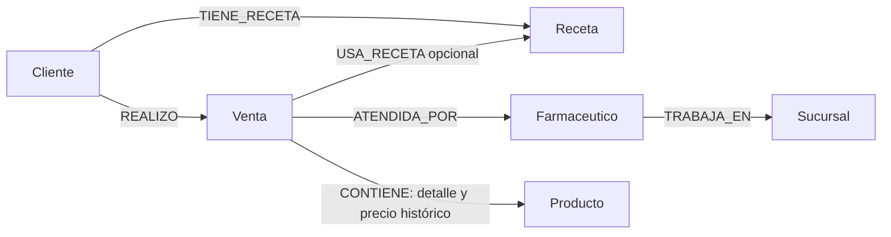

# Persona D — Síntesis para el informe general

## Elección y alcance de Neo4j

FarmaRed combina MongoDB, autoridad operacional, con Neo4j, proyección persistente
para Q03, Q04 y Q10. El modelo de grafos permite expresar directamente las relaciones
entre clientes, recetas, ventas y profesionales. MongoDB mantiene los agregados de
venta y las transacciones de negocio; Neo4j no autoriza dispensas ni modifica stock.
La decisión prioriza claridad del modelo y uso real de dos paradigmas NoSQL. No se
ha demostrado una ventaja de rendimiento: las consultas también podrían resolverse
con agregaciones MongoDB. Redis o Cassandra no aportan un caso de acceso que
justifique sumar la coordinación que exigirían en este alcance.

## Modelo de proyección

Se proyectan seis etiquetas con ID estable y unicidad por etiqueta: Cliente, Venta,
Receta, Farmaceutico, Sucursal y Producto. Las relaciones son:

Cada CONTIENE conserva id_detalle, orden, cantidad, precio_unit y subtotal; su
identidad lógica es (id_venta, id_detalle). Dos líneas del mismo producto permanecen
separadas. Los precios proceden del detalle histórico, no del catálogo actual.
Las fechas BSON se convierten primero a America/Argentina/Buenos_Aires y luego a
date Neo4j. Los importes se mantienen como enteros ARS. La integridad se valida en
la aplicación; las restricciones de unicidad no imponen por sí solas cardinalidades.

## Sincronización y consistencia

Los escritores MongoDB deben emitir outbox en la misma transacción de negocio.
El consumidor bajo demanda lee un evento pendiente, sus documentos actuales y
las dependencias completas dentro de un snapshot MongoDB. Cierra esa lectura,
proyecta toda la unidad en una transacción Neo4j y solo después confirma el evento
específico en MongoDB. Un fallo de confirmación admite reentrega: los upserts y la
reconciliación por agregado convergen sin duplicar detalles ni relaciones.

Se admite un solo consumidor efectivo. El bloqueo de archivo coordina procesos
que comparten ese archivo; no es un bloqueo distribuido entre hosts independientes.
No existe transacción ACID conjunta entre motores. Las consultas pueden reflejar
retraso: cero pendientes observado no garantiza consistencia futura ni inmediata
si continúan las escrituras. La demostración de equivalencia se realizó con las
escrituras pausadas y sin sincronizaciones superpuestas.

## Consultas y resultados oficiales

Q03 recibe id_cliente y combina ventas y recetas como eventos independientes,
con sus detalles, ordenados globalmente por fecha, tipo e ID; evita el producto
cartesiano. Q04 cuenta recetas distintas por cliente y conserva los casos con más
de una, ordenados por cantidad descendente e ID. Q10 recibe id_sucursal y recorre
la sucursal actual del farmacéutico que registró la venta. No excluye profesionales
inactivos; ninguna de estas consultas elimina historial por estado o actividad.
Este recorrido es compatible con la consulta 10 de la consigna, página 6. No se
modela un historial de traslados ni se sustituye por ventas.id_sucursal.

La ejecución del 10/11/2026 utilizó exclusivamente los nueve CSV originales y
nueve adicionales versionados, mediante el loader de A. El validador aprobó las
207 filas sin errores. Se importaron 169 documentos de negocio y se procesaron
120 eventos outbox sin fallos; Neo4j 5.26.12 quedó con 120 nodos, 142 relaciones y
seis restricciones. MongoDB ejecutado: 8.0.15, replica set rs0.

| Consulta | Parámetro | Resultado real |
| --- | --- | --- |
| Q03 | C001 | Seis eventos: dos recetas y cuatro ventas, incluida una anulada |
| Q04 | Sin parámetro | A-C001, A-C008, C001, C002 y C006; dos recetas cada uno |
| Q10 | A-S002 | A-C002, A-C003 y A-C009 |
| Q03 | C008, cliente existente | Historial vacío |

Los resultados completos coinciden con referencias independientes MongoDB.
También se contrastó Q10 para las quince sucursales. La verificación de contenido,
tipos y multiplicidades terminó sin diferencias. Repetir sync procesó cero eventos
y conservó el grafo y las salidas. Estas cifras corresponden al dataset oficial
más adicionales, no a fixtures sintéticos ni a un benchmark.

## Recuperación, pruebas y límites

Una reconstrucción en otro Neo4j vacío recuperó las seis colecciones autoritativas,
sin depender de eventos históricos ya procesados. Terminó habilitable=true, con
verificación equivalente y las mismas consultas, sin alterar MongoDB ni outbox.
Las pruebas con fixtures cubren además rollback, fallos de conectividad, ack fallido,
reentrega, referencias ausentes, cambios de sucursal, recetas y detalles repetidos.
La auditoría final reejecutó las suites con todas las integraciones habilitadas:
271 pruebas D aprobadas, ninguna omitida/fallida; 550 generales aprobadas, dos
omitidas por plataforma Windows y ninguna fallida. No hubo regresiones nuevas
ni se regeneraron las evidencias oficiales para obtener estos resultados.

La reconstrucción exige destino dedicado y confirmación administrativa de escritores
pausados; usa el mismo bloqueo y una sola transacción de datos Neo4j. Materializa
el snapshot y la comparación en memoria, por lo que queda limitada por memoria,
timeouts y tamaños de transacción. No hay batching, checkpoints ni conmutación
automática. El DDL de restricciones es incremental y está fuera de esa atomicidad.
No se eliminan nodos automáticamente; un destino con datos ajenos o sobrantes se
rechaza. El uso normal se habilita administrativamente tras verificar el resultado.
La demostración E2E es Windows con Docker; Codespaces alojado requiere validación
conjunta del equipo. No se implementan workers permanentes ni sincronización continua.

## Evidencias y material de integración

- [E2E oficial: comandos y salidas completas](../evidencias/d/e2e_oficial/README.md).
- [Informe técnico, contratos y Cypher definitivos](d_grafo_y_sincronizacion.md).
- [Auditoría final y matriz de requisitos](d_auditoria_final.md).
- [Bloque de uso preparado para README](d_bloque_readme.md).

Este texto está listo para incorporarse al informe general. La integración de
las otras consultas, servicios, documentación compartida y PDF final corresponde
al equipo; este cierre no certifica la entrega completa de A, B y C.
